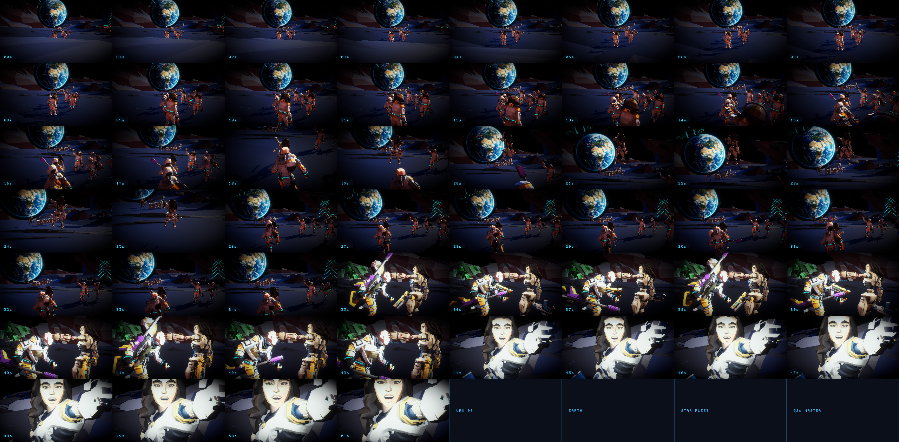
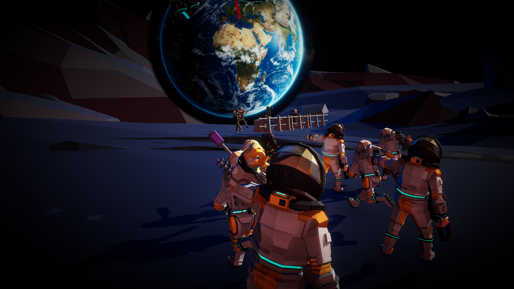
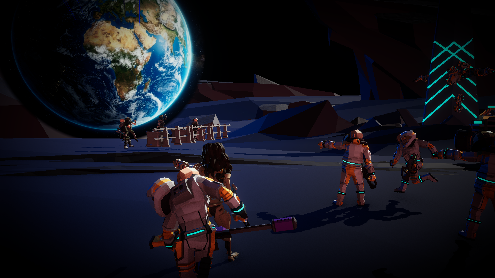

# 🌕 Alita: The Fall — Lunar Battle Flashback Cinematic (30s - 1min)

---

## 🎬 Cinematic Overview & Narrative Pillar

The **Moon Battle Flashback** is a continuous **52-second cinematic cutscene** recreating the legendary *The Fall* lunar assault from *Alita: Battle Angel*. Set on the desolate crater terrain outside a massive planetary defense fortress, Alita (Berserker Unit 99) and her U.R.M. spacesuit squad charge through low-gravity crossfire beneath a colossal, luminous blue Earth hanging in the black vacuum of space.

---

## 🎞️ 52-Second Master Cutscene Frame Matrix
Every second of the 52-second sequence (00s through 51s) sequentially captured:

---

## 🎬 6-Phase Storyboard Hero Frames

| Shot 1 (03s): Lunar Fortress Breach Vista | Shot 2 (12s): URM Vanguard Assault Charge |
| :---: | :---: |
|  |  |
| *Colossal photorealistic blue Earth rising above the lunar crater ridge with starfleet dogfights in orbit.* | *URM spacesuit vanguard squad charging across the regolith with pulse rifles and assault weapons.* |

| Shot 3 (21s): Alita Zero-G Combat Leap | Shot 4 (30s): Crater Ridge Firefight |
| :---: | :---: |
|  |  |
| *Alita mid-air zero-gravity leap with assault rifle and $0.35\times$ bullet-time against the glowing blue Earth.* | *Over-the-shoulder heavy firefight with muzzle flashes and beam tracers towards fortified defenders.* |

| Shot 5 (39s): Commander Gelda & Alita Bond | Shot 6 (48s): Alita Remembrance Close-Up |
| :---: | :---: |
|  |  |
| *Emotional two-shot profile as Commander Gelda clasps Alita's hand on the crater slope.* | *Macro push-in on Alita's face reflecting on the memories of the lunar fall.* |

---

## 🚀 Star Wars Space Fleet Battle & Dogfights
- **Delta-Wing Starfighter Squadron (Alpha):** 3 URM starfighters flying in tight delta formation across the face of Earth with brilliant cyan ion thruster glows.
- **Enemy Pursuit Interceptors (Beta):** 2 hostile interceptors in hot pursuit with lethal crimson engine afterburners.
- **Dogfight Laser Beams:** Procedural high-intensity glowing cyan (`#26e6ff`) and crimson (`#ff2640`) laser beams streaking across the lunar sky between fighters.
- **Low-Altitude Assault Gunship:** Heavy gunship sweeping low across the combat crater during Shots 2 & 3 with glowing engine flare.
- **Planetary Defense Railgun & Titan Mech:** 532m planetary defense cannon firing artillery bursts from the distant horizon mountain ridge.

---

## 🎞️ Storyboard Beat Sheet (Timecode Breakdown)

| Phase | Timecode | Shot Name | Framing & Camera Choreography | Narrative Action & Dialogue |
| :--- | :--- | :--- | :--- | :--- |
| **1. Fortress Breach** | `00:00 - 00:09` | `Wide_Fortress_Breach` | Ultra-wide panoramic push towards the colossal lunar defense wall; giant blue Earth rising over the crater ridge ($52^\circ \rightarrow 46^\circ$ FOV). | URM invasion forces charge across the crater plain under heavy bombardment.  **Sub:** `[LUNAR DEFENSE SECTOR 04 // THE FALL FLASHBACK]` |
| **2. Low-G Vanguard Charge** | `00:09 - 00:18` | `Low_Angle_Vanguard_Charge` | Dynamic ground-level tracking shot right beside the armored spacesuit squad sprinting and bounding across jagged crater regolith ($50^\circ \rightarrow 44^\circ$ FOV). | Vanguard squad advances under laser fire; boots kicking up low-g dust plumes.  **Speaker:** URM VANGUARD: *"Breach charge armed! Suppress the heavy towers! Push to the ridge!"* |
| **3. Zero-Gravity Leap** | `00:18 - 00:26` | `Alita_ZeroG_Leap` | Mid-air zero-gravity combat leap tracking Alita in low-gravity bullet time ($0.35\times$ timeScale), framing her directly against the blue marble of Earth. | Alita executes a soaring combat dive with assault rifle, firing downward at perimeter defenders.  **Speaker:** ALITA (99): *"Commander, I have angle on the perimeter bunker! Leaping in!"* |
| **4. Crossfire Clash** | `00:26 - 00:35` | `OTS_Ridge_Firefight` | Over-the-shoulder kinetic gunfight angle with camera shake and muzzle flare flashes ($46^\circ \rightarrow 40^\circ$ FOV). | Defense forces return heavy fire; squad takes tactical cover behind fortified barricades.  **Speaker:** GELDA (COMMANDER): *"Incoming heavy artillery! Hold the line, 99! On my mark!"* |
| **5. The Commander Bond** | `00:35 - 00:44` | `Commander_Hand_Clasp` | Two-shot emotional profile framed against the glowing Earth. Profile angle emphasizing solidarity and survival ($35^\circ \rightarrow 30^\circ$ FOV). | Alita hits the crater slope; Commander Gelda rushes in, lays down sniper cover, and reaches out her armored hand to pull Alita up.  **Speaker:** GELDA: *"I've got you. Stay focused, 99. Together we finish this!"* |
| **6. Iconic Remembrance** | `00:44 - 00:52` | `Alita_Iconic_Remembrance` | Slow cinematic push-in on Alita's face ($22^\circ \rightarrow 18^\circ$ FOV). War scratches on her cheeks; eyes wide reflecting the Earth in the black cosmos. | Slow motion fade as Alita's lost memory crystallizes before transitioning back to the present.  **Speaker:** ALITA: *"...I remember. That was the day we fought for the future."* |

---

## 🎨 Visual Aesthetics & Cinematography

1. **Anamorphic 2.39:1 Cinema Letterbox:**
   - Rendered natively in real-time via `AlitaMoonBattleCutsceneDirector.OnGUI()`.
   - Automatically adapts to any monitor aspect ratio (16:9, 16:10, 21:9) with ultra-clean matte borders.

2. **Frosted Dark Glass Subtitles:**
   - Translucent frosted glass panel with cyan speaker identification header (`#33E0FF`) and clean white subtitle dialogue.

3. **High-Contrast Stark Lunar Lighting:**
   - **Directional Sun:** Harsh single-source solar illumination with deep black unscattered shadows (`LightShadows.Hard`, intensity $2.85\text{f}$).
   - **Lunar Regolith Shading:** Triplanar terrain shaders calibrated to deep charcoal grey (`#3D3D42`) and volcanic rock (`#57575E`), eliminating lush flora for an authentic vacuum landscape.

4. **Colossal Blue Earth Skybox:**
   - Procedural high-resolution ocean-blue sphere with atmospheric rim emission (`#268CFF`, $2.6\times$ intensity), positioned directly on the lunar horizon at `(255, 85, 50)`.

---

## 🔊 Sound Design & Score

- **Combat Score (0:00 - 0:44):** High-tempo cyberpunk orchestral pulse (`Cyberpunk_Combat_Regime.mp3`) driving the vanguard charge and firefight intensity.
- **Emotional Score (0:44 - 0:52):** Somber, evocative synth strings (`Tears_in_the_Rain.mp3`) during the climactic close-up remembrance.
- **Weapon SFX:** High-velocity energy pulse tracers, ballistic ricochets, low-frequency crater artillery thuds, and vacuum radio voice chatter.

---

## 🎮 Master Controls & Director Keybindings

During playback in `Scene_Moon_Battle_Flashback`:

| Key | Function | Description |
| :--- | :--- | :--- |
| **`Space`** | **Pause / Resume** | Freezes cutscene time and camera motion |
| **`R`** | **Restart** | Rewinds to $t = 0.0\text{s}$ and restarts music |
| **`1`** | **Jump to Phase 1** | $t = 0.0\text{s}$ (Fortress Breach Vista) |
| **`2`** | **Jump to Phase 2** | $t = 9.0\text{s}$ (Vanguard Charge) |
| **`3`** | **Jump to Phase 3** | $t = 18.0\text{s}$ (Alita Zero-G Leap) |
| **`4`** | **Jump to Phase 4** | $t = 26.0\text{s}$ (Ridge Crossfire) |
| **`5`** | **Jump to Phase 5** | $t = 35.0\text{s}$ (Commander Hand Clasp) |
| **`6`** | **Jump to Phase 6** | $t = 44.0\text{s}$ (Iconic Remembrance) |
