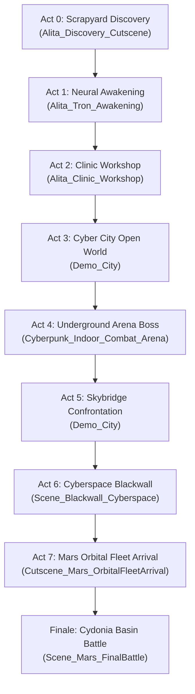

# 🎮 EdgeRunners 2026: Alita — Player Manual & Quick Start Guide

Welcome to **EdgeRunners 2026 (Alita: Battle Angel)**! This guide provides everything you need to start the game, master the combat mechanics, navigate the narrative campaign across Earth, Cyberspace, and Mars, or use quick developer jump shortcuts for gameathon evaluation.

---

## ⚡ Quick Start (Launch the Game in 60 Seconds)

### Step 1: Open the Project
1. Open **Unity Hub** and select Unity **6000.6.0f1** (Unity 6).
2. Open this project directory (`cyberpunk-dev-main`).

### Step 2: Load the Main Menu
1. In the Unity Project window, navigate to:
   ```
   Assets/Scenes/Scene_MainMenu.unity
   ```
   *(Alternatively, you can load `Assets/Scenes/Alita_Discovery_Cutscene.unity` for the cinematic prologue).*
2. Double-click the scene file to open it in the Editor.

### Step 3: Hit Play
1. Click the Unity **Play (▶)** button at the top center of the editor.
2. The real-time holographic start menu will load with animated ECG telemetry, scanlines, and ambient soundtrack.
3. Click **"START AWAKENING"** to begin the story campaign!

---

## 🕹️ Controls Reference Card

| Action | Keyboard & Mouse | Gamepad (Xbox / DualShock) |
| :--- | :--- | :--- |
| **Move** | `W`, `A`, `S`, `D` | Left Analog Stick |
| **Look / Aim** | Mouse Movement | Right Analog Stick |
| **Sprint** | `Left Shift` (Hold) | Left Stick Click (`L3`) |
| **Jump** | `Spacebar` | `A` / `Cross` |
| **Dodge / Dash** | `Left Ctrl` or `Alt` | `B` / `Circle` |
| **Light Attack (Combo 1-2-3)** | `Left Mouse Button` | `X` / `Square` |
| **Heavy Attack / Finisher** | `Right Mouse Button` | `Y` / `Triangle` |
| **Berserker Plasma Surge** | `Q` | Right Bumper (`RB` / `R1`) |
| **Interact / Dialogue / Doors** | `E` | `X` / `Square` (Hold/Tap) |
| **Inventory & Telemetry HUD** | `Tab` | View / Touchpad |
| **Pause / Menu** | `Escape` | Start / Options |

---

## 🗺️ Campaign Storyline & Scene Progression

The game follows Alita's chronological journey across 6 major acts:



### 1. Act 0: The Scrapyard Discovery (`Assets/Scenes/Alita_Discovery_Cutscene.unity`)
- Atmospheric acid rain downpour and dynamic lightning flashes over the Zalem trash heaps.
- Dr. Dyson Ido discovers Alita's severed URM Berserker chassis with a still-warm antimatter core.
- Single-take cinematic transition as Ido carries her back to his clinic.

### 2. Act 1: Neural Awakening (`Assets/Scenes/Alita_Tron_Awakening.unity`)
- 120-second immersive TRON-style boot sequence.
- Dr. Ido types diagnostics at a CRT workstation as Alita's cybernetic optical receptors boot up with real-time radial iris dilation.

### 3. Act 2: Clinic Workshop (`Assets/Scenes/Alita_Clinic_Workshop.unity`)
- First-person / third-person transition inside Dr. Ido's medical workshop.
- Inspect the diagnostic pods, interface with surgical equipment, and calibrate locomotion.

### 4. Act 3: Iron City Metropolis (`Assets/PolygonCyberCity/Scenes/Demo_City.unity`)
- Vast open-world neon city with flying traffic skyways, Syndicate hover tanks, and civilian NPC chatter.
- **Mission 1 (Street Trial):** Fight through Syndicate scout droids and test your three-tier thermal katana combo.
- Track waypoints to the Underworld Black Market and Underground Combat Arena.

### 5. Act 4: Underground Combat Arena & Boss Vulcan (`Assets/Scenes/Cyberpunk_Indoor_Combat_Arena.unity`)
- Enter the 56m colosseum tournament ring.
- Confront **Vulcan, Forge-Lord of Sector 04** in a multi-phase boss fight:
  - **Phase 1:** High-velocity hammer swings & ground cracks.
  - **Phase 2 (Overdrive):** Flame shockwaves and arena ring hazards.
  - **Phase 3 (Climax):** Berserker rage mode.
- Defeating Vulcan triggers the **Arena Confetti Celebration System** and roaring pit crowd ovations!

### 6. Act 5: Skybridge Confrontation (`Assets/PolygonCyberCity/Scenes/Demo_City.unity`)
- Dr. Ido contacts Alita to meet on the Sector 7 Skybridge.
- High-altitude cinematic encounter with the cyber-assassin **Switchblade**.

### 7. Act 6: Beyond the Blackwall (`Assets/Scenes/Scene_Blackwall_Cyberspace.unity`)
- Subterranean server room breach leading into the infinite audio-reactive Blackwall cyberspace realm.
- Water reflections, pulse lidar wall, and dialogue encounter with rogue AI entity Cynosure.

### 8. Finale: Mars Orbital Fleet & Final Battle (`Assets/Scenes/Scene_Mars_FinalBattle.unity`)
- Hyperspace jump to Mars orbit.
- Touchdown amidst the crimson sandstorms of Cydonia Basin.
- Retrieve the ancient URM core and face off against the colossal **Hammer Titan Mech**!

---

## 🚀 Gameathon Evaluator: Instant Dev Jump Shortcuts

For judges, evaluators, and speed-testers who want to jump straight to specific boss fights, cutscenes, or showcases without playing through sequentially:

Use the Unity Editor Top Menu Bar:

| Menu Path | Destination / Action |
| :--- | :--- |
| `Tools > Missions > Jump to Mission 1 (Street Trial)` | Loads `Demo_City` directly into combat. |
| `Tools > Missions > Jump to Mission 3 (Pit Arena)` | Loads `Cyberpunk_Indoor_Combat_Arena` ready for duel. |
| `Tools > Missions > Jump to Mission 4 (Vulcan Boss Showdown)` | Instantly triggers Vulcan's entrance & boss battle. |
| `Tools > Missions > Jump to Mission 5 (Server Room & Blackwall)` | Spawns Alita at the Cyberspace entrance door. |
| `Tools > Cutscenes > Generate Alita Discovery Cutscene` | Plays the God-of-War style opening cinematic. |
| `Tools > Cutscenes > Play Mars Orbital Fleet Arrival` | Plays the hyperspace fleet arrival sequence. |
| `Tools > Alita Battle Angel > Test Arena Confetti FX` | Triggers the celebratory victory confetti cannon eruption. |

---

## ⚔️ Combat Tips & Mechanics

1. **Light Combo Rhythm (`Left Click` × 3):**
   - Strike 1: Fast horizontal thermal slash.
   - Strike 2: Upward diagonal slash.
   - Strike 3: Piercing thrust with high knockback.
2. **Heavy Finisher (`Right Click`):**
   - Breaker strike designed to stagger enemies out of their attack animations.
3. **Dodge & Counter (`Left Ctrl`):**
   - Use dodge right as an enemy attack starts to trigger slow-motion hit-dilation.
4. **Berserker Surge (`Q`):**
   - Unleashes Alita's chest reactor antimatter shockwave, clearing all surrounding enemies in a 6-meter radius.

---

## 🏆 Summary

- **Title:** EdgeRunners 2026: Alita
- **Engine:** Unity 6 (6000.6.0f1)
- **Render Pipeline:** Universal Render Pipeline (URP 17.6.0)
- **Target Platform:** PC Standalone (Windows x64)
- **Repository:** https://github.com/parthhekbote/EdgeRunners2026
