# 🏙️ Cyberpunk Dev — Master Game Engine, Combat, Space & World Systems

[](https://unity.com/)
[](https://docs.unity3d.com/Packages/com.unity.render-pipelines.universal@17.6/manual/index.html)
[]()
[-cyan)]()
[]()
[]()
[](https://docs-multiplayer.unity3d.com/)
[-success)]()
[](HOW_TO_PLAY.md)
[](HOW_WE_MADE_THE_GAME.md)

An encyclopedic, AAA-grade **Cyberpunk Action RPG, Combat Sandbox, Space Opera & Multiplayer Engine** developed in **Unity 6 (Universal Render Pipeline 17.6.0)**. 

> 🎮 **How to Start & Play the Game:** Check out our player guide: [**HOW_TO_PLAY.md**](HOW_TO_PLAY.md) for step-by-step launch instructions, controls reference card, campaign walkthrough, and instant developer jump shortcuts.
>
> 📘 **Want to know how we engineered this game?** Read our comprehensive breakdown: [**HOW_WE_MADE_THE_GAME.md**](HOW_WE_MADE_THE_GAME.md) covering our entire technology stack, architecture, combat mechanics, and phased development journey.

The project documents and executes the complete cybernetic journey of **Alita (Berserker Unit 99)** across an expansive multi-planetary continuum: from her discovery in the desolate, acid-soaked Iron City scrap heaps beneath the sky city of Zalem, through a 120-second TRON neural awakening and a lunar war flashback to *The Fall* (Year 2263), into an open-world neon metropolis with an escalating 4-mission underworld campaign, a 56m colosseum tournament ring, a 200m audio-reactive Blackwall cyberspace barrier, a lawless deep space asteroid black market outpost, and an epic hyperspace voyage to Mars to confront the colossal **Colossus-06 Hammer Titan War Mech** amidst the sandstorms of Cydonia Basin.

---

## 📸 In-Engine Visual Showcase & Media Gallery

| Colossal 56m Duel Combat Arena Ring | High-Voltage Tron Sword Swing & Ribbon Trail |
| :---: | :---: |
| 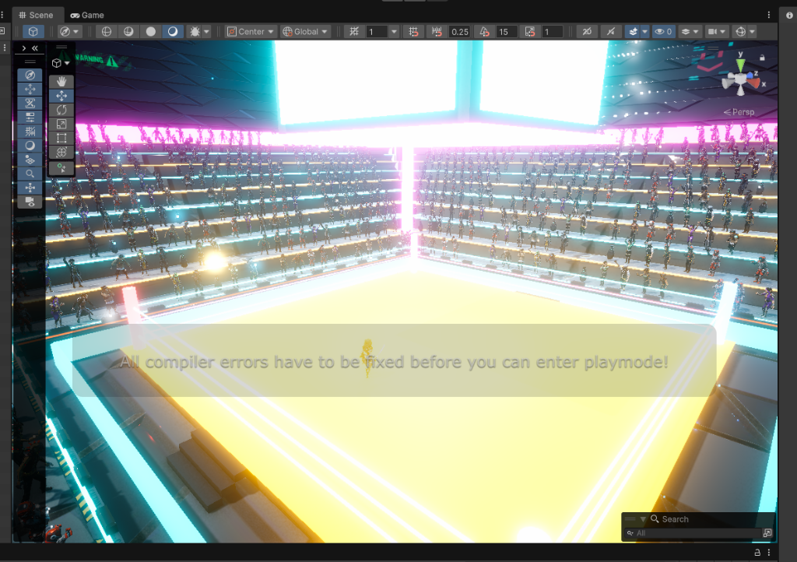 |  |
| *56m × 56m tournament platform with glowing Tron rings, suspended holographic cyber dragon, and 3-tier grandstands.* | *Alita executing light sword attack with electric cyan thermal katana and continuous Additive HDR ribbon trail.* |

| Beyond the Blackwall Cyberspace Arena | Zero-Lag Metropolis Flying Car Traffic |
| :---: | :---: |
| 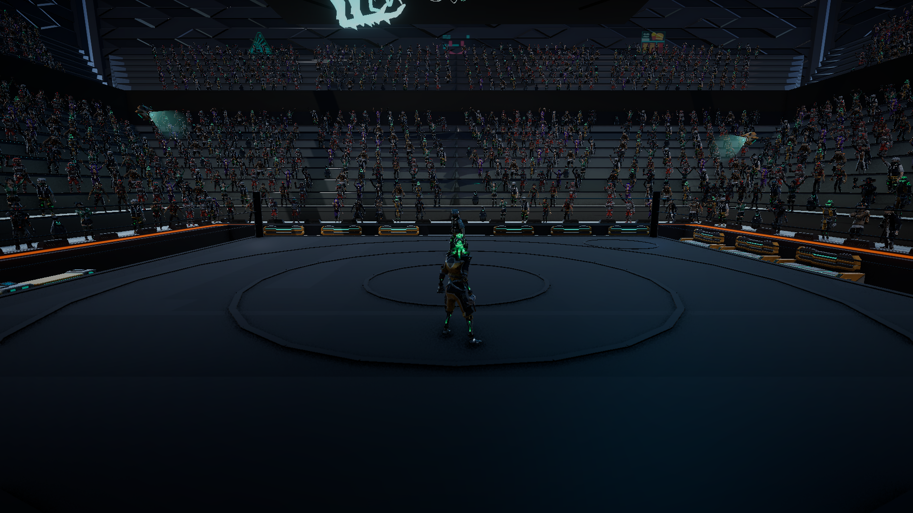 | 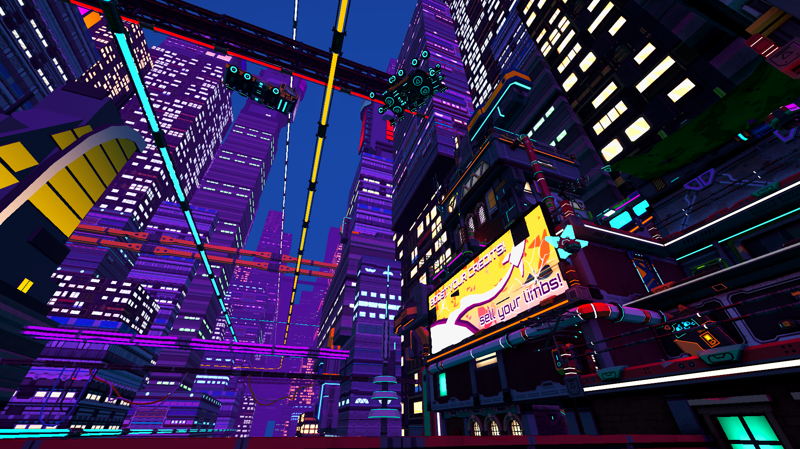 |
| *200m Ultra-HD audio-reactive Blackwall barrier with real-time planar mirror water reflections.* | *15 procedural hover cars navigating 3 closed-loop spline skyways over Cyber City.* |

| 🌕 Alita: The Fall Moon Battle Flashback | 🎬 Alita TRON: Ares Awakening Cutscene |
| :---: | :---: |
| 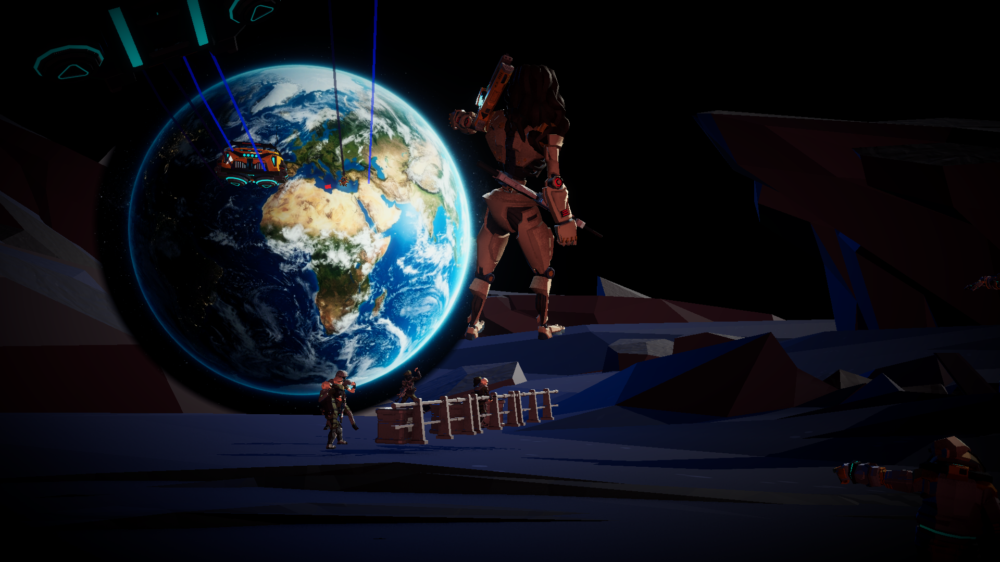 | 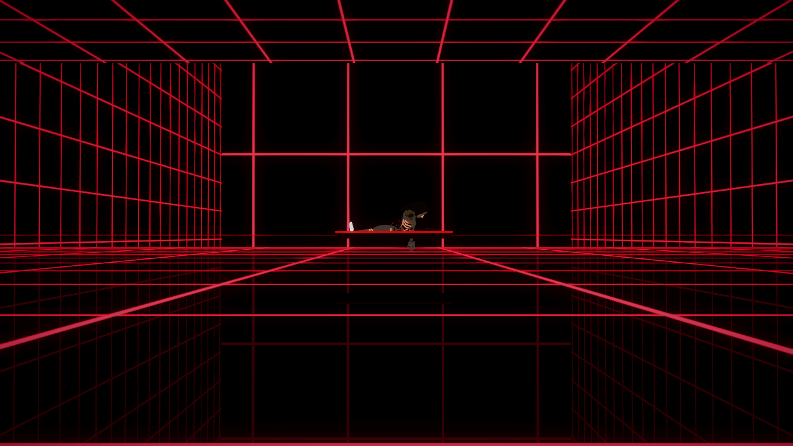 |
| *52-second cinematic cutscene: URM spacesuit squad assault on lunar fortress ridge with pulse rifles and colossal blue Earth.* | *120-second cinematic sequence: physical CRT boot console, voxel body reconstruction, and ARKit eyelid opening.* |

| 🚪 Server Room Airlock & Subterranean Corridor | 🌐 Gateway Door into the Blackwall Realm |
| :---: | :---: |
|  |  |
| *Pneumatic double-sliding door airlock on Cyber City upper plaza transitioning to subterranean datacenter.* | *Interactive portal gateway opening directly onto the infinite audio-reactive Blackwall cyberspace.* |

| 🌕 Lunar Assault: Shot 1 Fortress Breach | 🌕 Lunar Assault: Shot 3 Zero-G Leap |
| :---: | :---: |
| 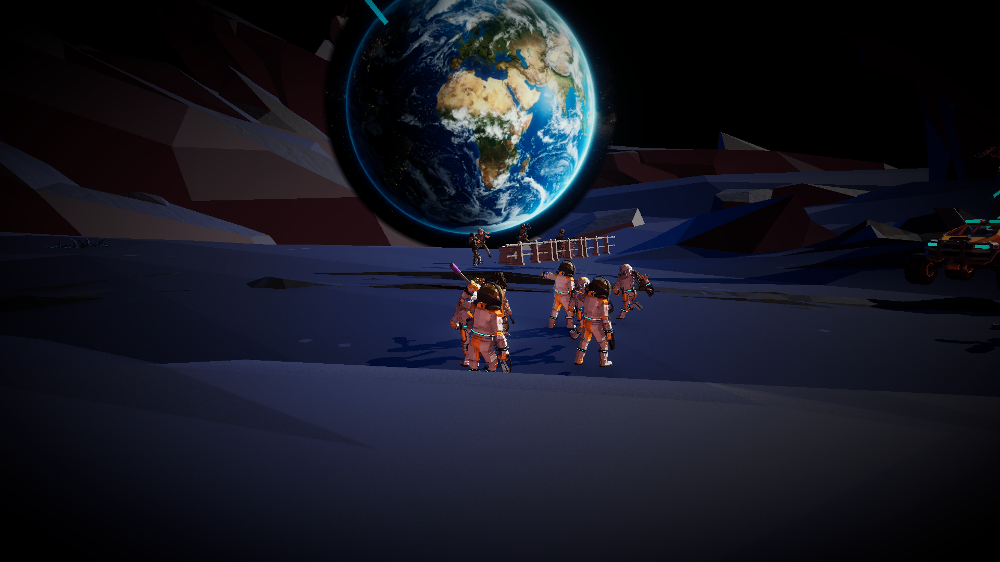 |  |
| *Panoramic vista of the colossal lunar defense fortress with starfighters dogfighting in vacuum orbit.* | *Alita executing mid-air assault dive in bullet time against the photorealistic blue marble of Earth.* |

| 🌕 Lunar Assault: Shot 5 Commander Bond | 🌕 Lunar Assault: Shot 6 Remembrance |
| :---: | :---: |
| 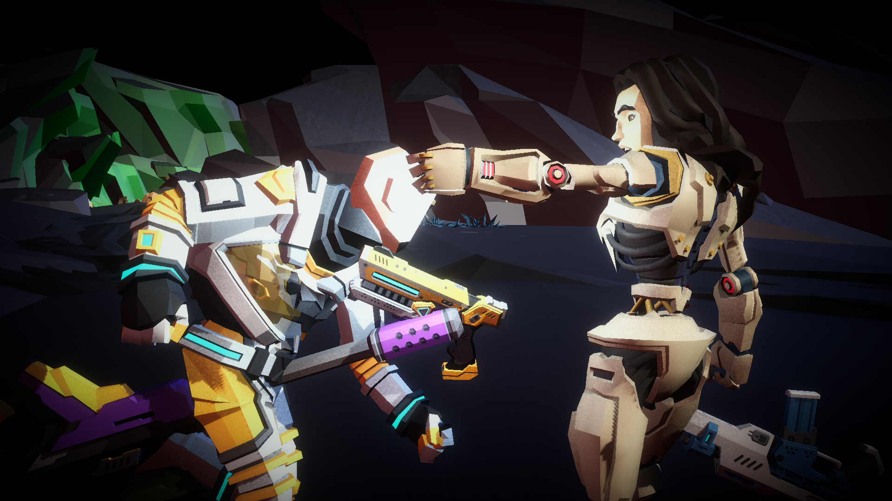 | 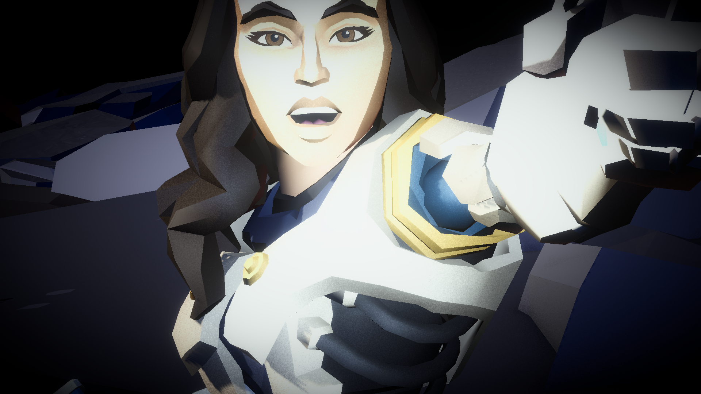 |
| *Emotional two-shot profile as Commander Gelda clasps Alita's hand on the crater slope.* | *Macro push-in on Alita's face reflecting on the memories of the lunar fall.* |

---

## 🎮 Engine & Technical Specifications

- **Game Engine:** Unity `6000.6.0f1` (Unity 6 Standalone)
  - **Git Branch:** `main`
  - **Repository:** `https://github.com/Yasxhwanth/cyberpunk-dev`
- **Render Pipeline:** Universal Render Pipeline (URP `17.6.0`)
- **Color Space:** Linear
- **Graphics APIs:** DirectX 11 / DirectX 12 / Vulkan
- **Post-Processing Stack:**
  - ACES Filmic Tonemapping
  - Radiant Emissive Bloom (Threshold: `1.1f`, Scatter: `0.68f`, Intensity: `0.65f` – `2.2f`)
  - Screen-Space Ambient Occlusion (SSAO) with multi-sample depth passes
  - Chromatic Aberration, Lens Distortion & Camera Rain Lens Wetness (`CameraRainLensFX.cs`)
- **Input Architecture:** Unity New Input System (`com.unity.inputsystem` v1.20.0) with comprehensive Legacy Input fallback
- **Multiplayer Architecture:** Unity Netcode for GameObjects (`com.unity.netcode.gameobjects`) with Unity Transport (`com.unity.transport`)
- **Audio Architecture:** Multi-channel 3D spatialized audio, real-time 64-band procedural FFT spectral analysis, dynamic software synths (`MechAudioSynth.cs`, `TronTerminalAudioEngine.cs`), and Edge-TTS Neural AI voice synthesis pipeline
- **Physics & Locomotion Engines:**
  - Hybrid Kinematic-Dynamic Locomotion with Euphoria Ragdoll momentum blending (`EuphoriaRagdollController.cs`)
  - SuperCharacterController physics engine with BSP trees, custom gravity manifolds, and slope sliding (`Math3d.cs`)
  - Two-handed inverse kinematics (`HammerTwoHandedGripIK.cs`)
- **Compilation Status:** 100% clean compilation across all runtime and editor assemblies (0 errors).

---

## 🗺️ Master Scene Index (All 25 Scenes & Demos)

The project includes **25 distinct Unity scenes** categorized into narrative acts, combat arenas, spaceflight sandboxes, exhibits, and technical benchmarks:

### 🎬 Narrative Campaign & Storyline Cutscenes
| Scene File | Path | Primary Director / Manager | Description & Systems |
| :--- | :--- | :--- | :--- |
| **`Alita_Discovery_Cutscene`** | `Assets/Scenes/Alita_Discovery_Cutscene.unity` | `AlitaCutsceneController.cs`, `IdoCarryAlitaRig.cs` | **Canonical Campaign Starting Hub**: God of War style continuous single-take sequence. Real-time main menu overlooking Alita in scrap heaps, sweeping crane pan behind Dr. Ido, debris clearance, vitals scan, and procedural lift & carry home. |
| **`Scene_Alita_Scrapyard_Discovery`** | `Assets/Scenes/Scene_Alita_Scrapyard_Discovery.unity` | `AlitaBrokenCyborg.cs`, `ScrapyardStormSystem.cs` | Narrative prologue environment: Scrapyard scrap heaps under torrential acid rain, lightning flashes, delayed thunder rumbles, and pulsing URM antimatter core. |
| **`Alita_Clinic_Workshop`** | `Assets/Scenes/Alita_Clinic_Workshop.unity` | `AlitaAwakeningCutsceneController.cs` | Dr. Ido's cybernetic surgical laboratory housing operating tables, diagnostic terminals, and cyberware workbenches. |
| **`Alita_Clinic_Awakening_Cutscene`** | `Assets/Scenes/Alita_Clinic_Awakening_Cutscene.unity` | `AlitaAwakeningCutsceneController.cs` | Clinic restoration: Hibernation pod depressurization, optic flare activation, eyelid opening, and Dr. Ido welcome dialogue. |
| **`Alita_Tron_Awakening`** | `Assets/Scenes/Alita_Tron_Awakening.unity` | `AlitaTronAwakeningDirector.cs`, `TronTerminalScreenAsset.cs` | **120s Cinematic Cutscene Engine**: Physical CRT boot terminal, vector laser eye burst, voxel body reconstruction, ARKit procedural eyelid zoom-out awakening, and 1:20 NIN sit-up in 6-sided Red Grid Chamber. |
| **`Scene_Moon_Battle_Flashback`** | `Assets/Scenes/Scene_Moon_Battle_Flashback.unity` | `AlitaMoonBattleCutsceneDirector.cs` | **52s Lunar Assault Cutscene**: "The Fall" battlefield recreation with *Star Wars*-style starfighter dogfights, URM assault squad, zero-g combat leaps, Commander Gelda clasp, and 2.39:1 letterboxing. |
| **`Demo_City`** | `Assets/PolygonCyberCity/Scenes/Demo_City.unity` | `AlitaCityPrologueDirector.cs`, `FlyingCarManager.cs` | **Open-World Cyberpunk Metropolis**: Autonomous flying car air traffic, monorail system, Behavior Tree crowds, Mission 1 Street Trial, Mission 2 Scalper Chase, and pneumatic server room airlock doors. |
| **`Demo_Interior`** | `Assets/PolygonCyberCity/Scenes/Demo_Interior.unity` | `CyberCitySmartObjectBuilder.cs` | **Metropolis Interior & Living Quarters**: Highly detailed interior environment with corporate offices, hacker dens, residential cyber suites, and smart objects. |
| **`Demo_BlackMarket_01`** | `Assets/Synty/PolygonSciFiWorlds/Scenes/Demo_BlackMarket_01.unity` | `BlackMarketArrivalCutsceneDirector.cs`, `BlackMarketStoryCombatDirector.cs` | **Sector 04 DRIFT Asteroid Port**: Starship flight approach, GotG title card, 60+ dynamic NPCs, Dockmaster Silas, Voss/Collector betrayal ambush, catwalk collapse, and Pad B-04 escape. |
| **`Scene_Mars_FinalBattle`** | `Assets/Scenes/Scene_Mars_FinalBattle.unity` | `MarsArrivalCutsceneDirector.cs`, `MarsFinalBattleDirector.cs` | **The Final Siege of Mars**: Orbital hyperspace arrival over Cydonia Basin beneath Phobos, atmospheric entry dust storm, Colossus-06 Hammer Titan War Mech boss encounter, and plasma blade duel. |
| **`GameCredits_CorporationHead`** | `Assets/SyntyCombined/Scenes/GameCredits_CorporationHead.unity` | `CelestialVisionCutsceneDirector.cs` | **Cinematic Epilogue & End Credits**: Deep cosmic space standoff against the mysterious robed Corporation Overseer with radiant nebula lighting. |

### ⚔️ Combat Arenas & Boss Sandboxes
| Scene File | Path | Primary Controller | Description & Systems |
| :--- | :--- | :--- | :--- |
| **`Cyberpunk_Indoor_Combat_Arena`** | `Assets/Scenes/Cyberpunk_Indoor_Combat_Arena.unity` | `CyberpunkIndoorArenaBuilder.cs`, `ArenaSpectatorCrowdSpawner.cs` | **56m Colosseum Tournament Arena**: 56m canvas duel ring, 3 concentric Tron rings, 550 dynamic zero-lag spectators, suspended holographic cyber dragon, Mission 3 Pit Fight ladder, and Mission 4 Vulcan Showdown. |
| **`Scene_Blackwall_Cyberspace`** | `Assets/Scenes/Scene_Blackwall_Cyberspace.unity` | `BlackwallRogueAIBarrier.cs`, `CyberspacePlanarMirror.cs` | **Subterranean Datacenter & Cyberspace**: 200m audio-reactive Blackwall barrier, planar mirror water reflections, Cynosure AI dialogue, and Rogue AI holographic materialization. |
| **`InsaneGun_Combat_TestArena`** | `Assets/Scenes/InsaneGun_Combat_TestArena.unity` | `InsaneGunCombatTestManager.cs` | Dedicated combat test arena for benchmarking Alita's 7-hit katana combos, Gun-Kata shooting, dodge rolls, and slow-motion against live enemy spawns. |
| **`SyntyCombatDemo`** | `Assets/Scenes/SyntyCombatDemo.unity` | `SyntySwordLocomotionController.cs`, `SyntyTrainingDummy.cs` | Rapid combat benchmarking sandbox with training dummies, weapon hitboxes, and floating damage numbers. |
| **`Demo` (Polygon Mech)** | `Assets/PolygonMech/Scenes/Demo.unity` | `BossMechAI.cs`, `PolygonMechURPConverter.cs` | Polygon Mech environment sandbox for testing chassis loadouts and weapon mounts. |

### 🚀 Spaceflight, Technical Showcases & Exhibits
| Scene File | Path | Primary Controller | Description & Systems |
| :--- | :--- | :--- | :--- |
| **`Scene_MainMenu`** | `Assets/Scenes/Scene_MainMenu.unity` | `MainMenuController.cs` | AAA Cyberpunk Main Menu with Title Screen, Quick Start, Sector Map Overview, Settings, Controls, and audio management. |
| **`Showcase_AllSpaceships_FleetLineup`** | `Assets/Scenes/Showcase_AllSpaceships_FleetLineup.unity` | `SpaceshipFleetShowcaseController.cs` | **Interactive Spaceship Fleet Showcase**: Orbit inspection camera, supersonic runway flyby mode, grand armada formation toggling, and tactical telemetry HUD. |
| **`Mech_Animations_Showcase`** | `Assets/Scenes/Mech_Animations_Showcase.unity` | `MechShowcaseManager.cs`, `MechShowcaseExhibit.cs` | **Goliath Titan Mech Exhibit**: Museum-style showcase demonstrating all **32 custom mech combat animations**, weapon socketing, and boss combat tuning. |
| **`HammerMech_AnimationShowcase`** | `Assets/Scenes/HammerMech_AnimationShowcase.unity` | `HammerMechShowcaseViewer.cs` | Dedicated exhibit for the Colossus-06 Hammer Mech, demonstrating two-handed grip IK, rocket war hammer impacts, and screen-shake feedback. |
| **`InsaneGun_Sword_Showcase`** | `Assets/Scenes/InsaneGun_Sword_Showcase.unity` | `InsaneGunShowcaseSetup.cs` | Weapon gallery showcasing the high-voltage Tron Katana, dual-layer ribbon trails, and directional slash arcs. |
| **`Scene_Alita_3States_Showcase`** | `Assets/Scenes/Scene_Alita_3States_Showcase.unity` | `AlitaSidekickEvolutionBuilder.cs` | Character progression exhibit comparing Alita's 3 historical bodies: Broken Scrapyard Core, DollBody, and Berserker Combat Armor. |
| **`Tron_Terminal`** | `Assets/Scenes/Tron_Terminal.unity` | `TronTerminalController.cs`, `TronAudioSpectrumVisualizer.cs` | Interactive ENCOM 511 retro CRT mainframe CLI with real-time audio spectrum visualizer and 400m infinite cyberspace floor grid. |

### 🔬 Technical Benchmarks & Synty Galleries
| Scene File | Path | Description |
| :--- | :--- | :--- |
| **`Overview`** | `Assets/Synty/PolygonGeneric/Scenes/Overview.unity` | Synty asset catalog showcase. |
| **`Demo_01`** | `Assets/Synty/PolygonParticles/Scenes/Demo_01.unity` | Visual particle effects gallery (lasers, sparks, fires). |
| **`Demo_Corporation_01`** | `Assets/Synty/PolygonSciFiWorlds/Scenes/Demo_Corporation_01.unity` | Megacorp corporate headquarters environment showcase. |
| **`Demo_Explorer_01`** | `Assets/Synty/PolygonSciFiWorlds/Scenes/Demo_Explorer_01.unity` | Deep space explorer base environment. |
| **`Demo_Scavenger_01`** | `Assets/Synty/PolygonSciFiWorlds/Scenes/Demo_Scavenger_01.unity` | Waste salvager colony environment. |

---

## 📖 Complete Narrative Campaign Flowchart & 8-Act Progression

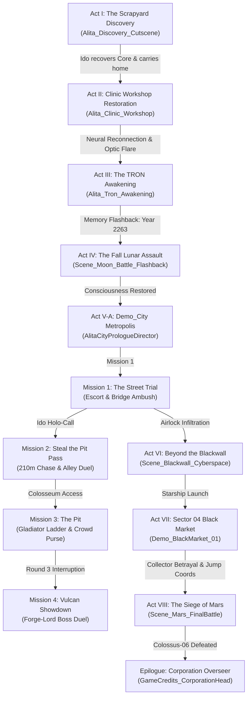

### 1. Act I: The Scrapyard Discovery
- **Setting:** The desolate Iron City scrap heaps beneath the sky city of Zalem under torrential acid rain.
- **Story:** Dr. Dyson Ido scavenges the fallen mechanical refuse, detecting a warm quantum signature from a 300-year-old cyborg core. He clears the rubble, examines her intact human brain and warm antimatter core, and gently gathers her in his arms to carry her back to his clinic.
- **Key Scripts & Tech:** God of War style single-take camera director (`AlitaCutsceneController.cs`), custom procedural lift and carry rig (`IdoCarryAlitaRig.cs`), real-time ragdoll physics (`RealtimeRagdollDragger.cs`), dynamic thunderstorm lighting (`ScrapyardStormSystem.cs`), and neural-synthesized voice acting (`generate_neural_voice.py`).

### 2. Act II: Clinic Restoration & Surgical Awakening
- **Setting:** Dr. Ido's cybernetic operating laboratory.
- **Story:** Dr. Ido meticulously grafts Alita's core and brain into an antique porcelain DollBody. At system depressurization, her optical photoreceptors ignite with a brilliant cyan optic flare as Dr. Ido welcomes her back to the living world.
- **Key Scripts & Tech:** `AlitaAwakeningCutsceneController.cs`, `AlitaClinicWorkshop`, and interactive diagnostic terminals.

### 3. Act III: The TRON Awakening
- **Setting:** The 6-sided TRON Red Grid Chamber inside Alita's bootloader visual cortex.
- **Story:** A physical ENCOM 511 CRT terminal initiates diagnostic teletype routines. A vector laser burst triggers a nano-cube voxel body reconstruction. As the camera pulls out from her pupil across 8.2 continuous seconds, her eyelids part in wonder and consciousness to Nine Inch Nails' *Init*, culminating in a sit-up at the 1:20 mark.
- **Key Scripts & Tech:** Teletype terminal asset (`TronTerminalScreenAsset.cs`), nano-cube voxel synthesis (`AlitaTronAwakeningReconstructionVFXSystem.cs`), and 88-blendshape ARKit procedural eyelid opening director (`AlitaTronAwakeningDirector.cs`).

### 4. Act IV: The Fall — Lunar Battle Flashback
- **Setting:** The Mare Imbrium crater ridge on the Moon during *The Fall* (Year 2263).
- **Story:** Alita experiences a traumatic memory surge recalling her service as a U.R.M. (United Republic of Mars) shock trooper (Berserker Unit 99). Alongside Commander Gelda, she charges through lunar crossfire beneath a colossal photorealistic Earth, leaping across craters in bullet-time gun-kata amidst Star Wars-style starfighter dogfights.
- **Key Scripts & Tech:** 52-second contact-sheet master director (`AlitaMoonBattleCutsceneDirector.cs`), Star Wars delta-wing starfighter dogfights, procedural ion laser beams, 2.39:1 anamorphic letterbox, and dual orchestral score (*Cyberpunk Combat Regime* & *Tears in the Rain*).

### 5. Act V: Open-World Metropolis & The 4-Mission Campaign Arc
- **Setting:** The neon-drenched streets, elevated skyways, and underground arenas of Cyber City.
- **Story & Campaign Structure:**
  - **City Prologue:** Dr. Ido introduces Alita to the ruthless corporate reality of Iron City (`AlitaCityPrologueDirector.cs`).
  - **Mission 1 — The Street Trial (`Mission1_StreetTrialManager.cs`):** Alita is escorted through hostile mercenary street sectors, leading to a multi-wave ambush on the city bridge arena and reaching the classified Blackwall server room airlock door.
  - **Mission 2 — Steal the Pit Pass (`Mission2_ArenaPassStealManager.cs`):** Dr. Ido contacts Alita via holo-call: a Razor scalper on the skybridge possesses a VIP Pit pass. Alita pursues the scalper across a 210m verified NavMesh chase route (Skybridge $\rightarrow$ Terrace Mid-Landing $\rightarrow$ Clinic Plaza $\rightarrow$ Lower Alley Van) with dynamic rubber-banding, culminating in a 1v1 cornered duel and an interactive `[E] RIP PASS` execution.
  - **Mission 3 — The Pit (`Mission3_PitFightManager.cs`):** Gladiator ladder combat inside the colossal 56m arena. Alita duels increasingly formidable opponents across consecutive rounds with dynamic battle drums, 550 cheering spectators, and instant eurodollar (€$) purse payouts.
  - **Mission 4 — Vulcan Showdown (`Mission4_VulcanShowdownManager.cs`):** Following Round 3, a 7-shot cinematic cutscene hijacks the arena: all floodlights cut, war drums halt, jumbotron displays a glitch override, and Vulcan (Forge-Lord of Sector 04) crashes down in a fiery skyward thunder drop. Alita battles through 3 escalating phases (The Duelist $\rightarrow$ Meltdown Surge $\rightarrow$ Judgement of the Forge), finishing with a kneeling execution prompt `[E] FINISH`.

### 6. Act VI: Beyond the Blackwall Cyberspace
- **Setting:** Subterranean datacenter vault and the infinite cyberspace threshold.
- **Story:** Passing through the pneumatic server room airlock, Alita encounters the towering 200m audio-reactive Blackwall barrier separating human networks from rogue AI swarms. Cynosure AI voice transmissions echo as holographic combatants emerge directly through the digital plane.
- **Key Scripts & Tech:** 576,000-vertex Blackwall mesh (`Blackwall_UltraHD_200m_Mesh.asset`), 64-band audio FFT mesh displacement, real-time URP planar mirror water reflection (`CyberspacePlanarMirror.cs`), and holographic dissolve emergence (`Cyberpunk_Holographic_RogueAI.shader`).

### 7. Act VII: Sector 04 DRIFT Black Market & Nowhere Asteroid Port
- **Setting:** The lawless asteroid trading outpost of Nowhere in deep space.
- **Story:** Alita boards her starship and navigates a 3D Bezier flight trajectory into Nowhere asteroid port (Pad B-04). She explores the alien cantina with 60+ dynamic NPCs to meet "The Collector" / Voss to trade her antimatter core for Mars hyperspace jump coordinates. Voss betrays her, triggering Omni-Corp's 10M credit bounty alarm. A gantry explosion shatters the high catwalk, dropping Alita 4 meters into the cargo trench where she fights off bounty hunters and a Syndicate Hover Tank (`SyndicateHoverTankAI.cs`) before sprinting back to Pad B-04 and engaging `[R]` Hyperspace Warp.
- **Key Scripts & Tech:** `BlackMarketArrivalCutsceneDirector.cs`, `BlackMarketStoryCombatDirector.cs`, `CollectorBetrayalManager.cs`, `BlackMarketNPCPopulator.cs`, `GotGTitleCardUI.cs`, and `SpaceshipFlightController.cs`.

### 8. Act VIII: The Final Siege of Mars — Cydonia Basin
- **Setting:** The windswept red sands and ancient excavation canyons of Cydonia Basin, Mars.
- **Story:** Exiting hyperspace over Mars with celestial Phobos overhead, Alita touches down amid a violent red dust storm. She disembarks, draws her plasma Damascus blade, and faces the ultimate corporate war machine: **COLOSSUS-06 TITAN WAR MECH**, armed with a colossal rocket-propelled war hammer.
- **Key Scripts & Tech:** 4-shot cinematic arrival director (`MarsArrivalCutsceneDirector.cs`), camera-following sand particles and wind audio (`MartianDustStormSystem.cs`), Colossus-06 AI (`HammerMechAI.cs`), two-handed grip IK (`HammerTwoHandedGripIK.cs`), rocket hammer booster flares (`HammerRocketBooster.cs`), and seismic ground shockwave rings (`BossTelegraphDecal.cs`).

### Epilogue: The Corporation Overseer Standoff
- **Setting:** Deep cosmic space backdrop (`GameCredits_CorporationHead.unity`).
- **Story:** Narrative closing sequence confronting the gold-masked, robed corporate overlord overseeing the solar system's megacorporations, setting the stage for future expansion.

---

## ⚔️ Master Player & Character Architecture (Alita)

Alita's architecture is built on a 3-tier evolutionary chassis progression, dual combat controllers, and an ARKit-grade facial rig:

### 1. 🦾 The Three Canonical Body Chasses
1. **Broken Scrapyard Core (`Alita_01_Scrapyard_Broken.prefab` / `AlitaBrokenCyborg.cs`):**
   - Discarded URM Berserker torso with exposed quantum antimatter core pulsing at 55 BPM.
   - Severed cybernetic cables with dynamic electric spark emitters and severed spinal bone rig.
   - Interactive diagnostic scan HUD that displays quantum core integrity and neural latency.
2. **Porcelain DollBody (`Alita_02_Normal_DollBody.prefab` / `SM_Alita_HumanCustom`):**
   - Antique engraved porcelain chassis crafted by Dr. Dyson Ido.
   - Houses the complete 88-blendshape ARKit facial deformation rig.
   - Equipped with dynamic cloth and physics-driven hair simulation.
3. **Berserker Combat Armor (`Alita_03_Final_NanoBerserker.prefab` / `Alita_BattleAngel_Hero.prefab`):**
   - Self-assembling Martian nanotech combat suit responsive to instinctive brain impulses.
   - Integrated plasma Damascus thermal blade sockets and Damascus hip sheaths (`SM_Wep_Sword_01_Sheath_01.prefab`).
   - Glowing muscle fiber conduits that flare dynamically based on combo intensity and bullet-time slow motion.

### 2. 👁️ ARKit 88-Blendshape Facial Awakening System
*Components: `AlitaTronAwakeningDirector.cs`, `AlitaAwakeningCutsceneController.cs`, `SM_Alita_HumanCustom`*

Alita's DollBody features an ARKit-grade facial rig with **88 distinct blendshapes** supporting nuanced emotive performance, ocular tracking, and procedural eyelid dynamics:

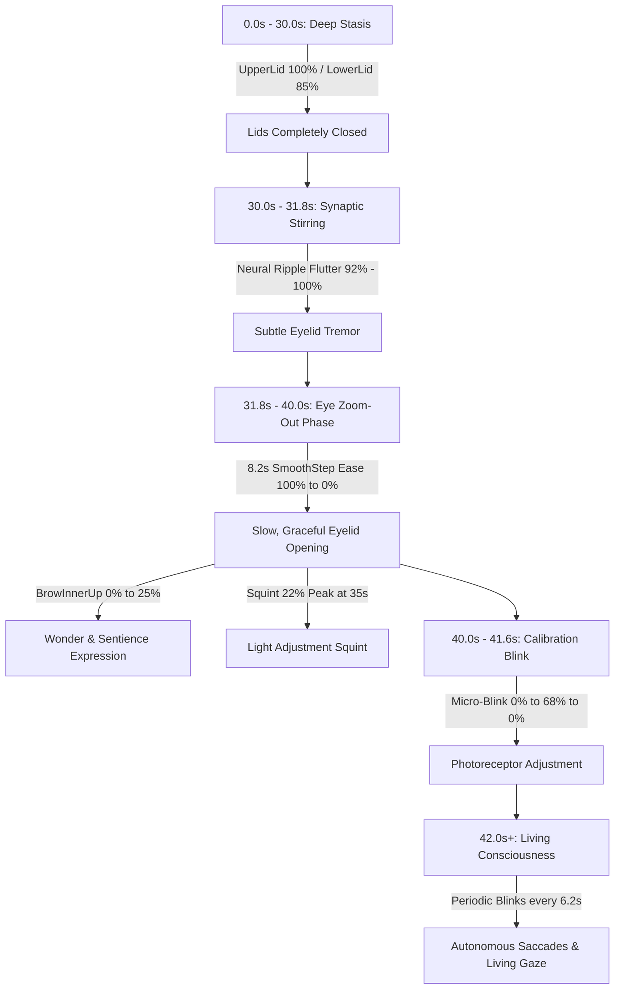

- **Key Blendshape Indices:**
  - `eyeBlinkUpperLeft` [29] & `eyeBlinkUpperRight` [39]
  - `eyeBlinkLowerLeft` [6] & `eyeBlinkLowerRight` [16]
  - `browInnerUpLeft` [74] & `browInnerUpRight` [80]
  - `eyeSquintLeft` [41] & `eyeSquintRight` [44]
  - `eyeWideUpperLeft` [1] & `eyeWideUpperRight` [19]
- **Procedural Eyelid Awakening Timing:**
  - **30.0s – 31.8s:** Neural current micro-flutter (eyelids ripple between 92% and 100%).
  - **31.8s – 40.0s:** As the camera pulls out from the pupil, her eyelids part smoothly across **8.2 continuous seconds** (100% $\rightarrow$ 0%), while inner eyebrows rise to 25% in wonder and awareness.
  - **40.0s – 41.6s:** A gentle 0.8s photoreceptor calibration blink (0% $\rightarrow$ 68% $\rightarrow$ 0%) as her eyes adjust to the neon chamber lighting.
  - **42.0s+:** Ambient living blinks every ~6.2 seconds and breathing brow oscillations.

---

### 3. ⚔️ Dual Combat Locomotion Controllers

#### A. The High-Voltage TRON Combat Controller (`InsaneGunSwordController.cs`)
- **Master 47-State Animator Controller (`AC_InsaneGun_CombatMaster.controller`):**
  - **7-Hit Directional Light Sword Combo (LMB):**
    - Hit 1: Horizontal forward swipe ($0^\circ$)
    - Hit 2: Downward diagonal backhand slash ($35^\circ$)
    - Hit 3: Rising diagonal uppercut crescent ($-40^\circ$)
    - Hit 4: Piercing plasma thrust flare ($90^\circ$)
    - Hit 5: Heavy vertical overhead cleave ($90^\circ$)
    - Hit 6: Full $360^\circ$ whirlwind horizontal spin ($0^\circ$)
    - Hit 7 (Finisher): Colossal $2.2\times$ Tron chromatic rupture crescent ($85^\circ$)
  - **Dual-Layer Katana Ribbon Trails (`TrailRenderer`):**
    - Tip Ribbon (`Tron_Blade_Tip_Trail`): Socketed at blade tip ($Z = -0.92\text{m}$) with a tapered $0.52\text{m} \rightarrow 0.01\text{m}$ width curve.
    - Mid Ribbon (`Tron_Blade_Mid_Trail`): Socketed at mid blade ($Z = -0.48\text{m}$) with a $0.32\text{m}$ width curve for an intense glowing core.
    - Additive HDR Materials (`Universal Render Pipeline/Particles/Unlit`, `_Blend = 1`, `LineTextureMode.Stretch`, HDR color multiplier $3.5\times$).
  - **3-Phase Heavy Finisher Strikes (RMB):** Charged strikes triggering ground-shattering neon fissures and dynamic point-light detonation flashes.
  - **Gun-Kata Firearms (`F`):** Instant sidearm draw firing high-velocity laser beam tracers with muzzle shockwave rings.
  - **4-Way Omnidirectional Dodge Roll (`Space`):** Local movement quadrant mapping (`avoid_front`, `avoid_back`, `avoid_left`, `avoid_right`) with invulnerability frames (i-frames).
  - **⏱️ Bullet Time Slow-Motion Engine (`T` / `Left Alt`):** Smooth time-scale interpolation to **0.25x speed**, audio pitch-warping, real-time energy depletion and recharge, and holographic ghost mesh projection bursts (`HolographicGhostEmitter.cs`).
  - **"Press R to Reboot" Neural Recovery Sequence:** When Alita's health is depleted, pressing **R** executes an emergency core reboot cycle, recalibrating cybernetics and restoring combat readiness with glitch UI overlay.
  - **Euphoria Dynamic Ragdoll Physics (`EuphoriaRagdollController.cs`, `EuphoriaRagdollManager.cs`):** Fluid kinetic transitions between animated states and physics ragdoll momentum upon heavy impacts.

#### B. The Synty Sword Locomotion Controller (`SyntySwordLocomotionController.cs`)
- **Three-Layer Animator Architecture:**
  - **Layer 0 — Locomotion:** Full-body blend trees, idle sword blends, crouch, and jumping.
  - **Layer 1 — UpperBody_SwordStance:** Arm-masked ready stance while moving with drawn blade.
  - **Layer 2 — Combat_Actions:** Full-body override for attacks, dodges, parries, and damage reactions.
- **Dynamic Animation Resolving (`SyntyCombatAnimationResolver.cs`, `SyntyAnimClipData.cs`):** Clip durations read directly from `AnimationClip.length` (never hardcoded) with `CrossFadeInFixedTime`.
- **Dynamic Weapon Socketing (`WeaponSocketController.cs`):** Seamless weapon grip attachment to Synty `Prop_R` hand bone and hip sheath (`SM_Wep_Sword_01_Sheath_01.prefab`) with frame-exact draw/sheathe swaps (`Z`).
- **Damage Interface (`ISyntyDamageable.cs`):** Universal damage system supporting hit direction, damage type, poise reduction, and ragdoll force.

---

## 🦾 Goliath & Colossus Titan Mech Boss Architecture
*Scenes: `Mech_Animations_Showcase.unity`, `HammerMech_AnimationShowcase.unity`, `Scene_Mars_FinalBattle.unity`*
*Scripts: `BossMechAI.cs`, `SamuraiMechAI.cs`, `HammerMechAI.cs`, `HammerRocketBooster.cs`, `HammerTwoHandedGripIK.cs`, `BossHealthBar.cs`, `BossTelegraphDecal.cs`*

A multi-chassis boss platform engineered for phased encounters, featuring downward attack biasing designed specifically for battling the smaller, agile Alita:

- **Museum-Style 32-Animation Showcase Exhibit (`Mech_Animations_Showcase.unity`):**
  Interactive switching across all **32 custom mech combat animations**:
  1. `Idle_Calm` / `Idle_Combat_Stance`
  2. `Walk_Forward`, `Walk_Backward`, `Turn_Left_90`, `Turn_Right_90`
  3. `Run_Charge_Sprint`
  4. `Light_Slash_Horizontal`, `Light_Slash_Diagonal`, `Light_Slash_Backhand`
  5. `Heavy_Cleave_Overhead`, `Heavy_Cleave_Execution`
  6. `Ground_Stomp_Left`, `Ground_Stomp_Right`, `Double_Foot_Shockwave`
  7. `Whirlwind_360_Sweep`, `Whirlwind_Reverse_Spin`
  8. `Thrust_Forward_Impale`, `Shield_Bash_Deflect`
  9. `Titan_Hammer_Overhead_Smash`, `Titan_Hammer_Side_Crush`
  10. `Micro_Missile_Barrage_Open`, `Micro_Missile_Fire_Salvo`
  11. `Chest_Laser_Charge`, `Chest_Laser_Beam_Sweep`
  12. `Hit_React_Front_Light`, `Hit_React_Heavy_Stumble`, `Stagger_Kneel`
  13. `Shield_Guard_Hold`, `Taunt_Roar_Flex`
  14. `Defeat_Fall_Backwards`, `Victory_Howl`
- **Colossus-06 Rocket War Hammer System (`HammerMechAI.cs`):**
  - **Two-Handed Grip IK (`HammerTwoHandedGripIK.cs`):** Procedural inverse kinematics locking the secondary hand onto the hammer shaft during dynamic swings.
  - **Rocket Booster Exhaust (`HammerRocketBooster.cs`):** High-temperature flame plumes igniting at the apex of heavy swings to deliver explosive kinetic acceleration.
  - **Seismic Ground Decals (`BossTelegraphDecal.cs`):** Expanding projected ground rings telegraphing shockwaves before hammer impact.
- **Boss Health & Shield HUD (`BossHealthBar.cs`):** Segmented health bar displaying armor durability, active energy shield absorption, and phase transition alerts.

---

## 🚀 Starfighter Flight Physics & Spaceship Fleet
*Scenes: `Showcase_AllSpaceships_FleetLineup.unity`, `Demo_BlackMarket_01.unity`*
*Scripts: `SpaceshipFlightController.cs`, `SpaceshipFleetShowcaseController.cs`, `AAAStarshipThrusterSystem.cs`*

- **6-DOF Arcade Starfighter Flight Dynamics:**
  - **Cruise Speed:** 55 m/s (~198 km/h); **Afterburner Boost:** 120 m/s (~432 km/h).
  - **Anti-Gravity Ground Cushion:** Repulsor raycasts continuously cushion hover height above terrain, preventing unwanted ground clipping.
  - **Rotational Steering:** Gimbal-free Euler composition (Pitch: 85°/s, Yaw: 95°/s, dynamic banking roll up to 36°).
  - **Weapon Systems:** Dual rapid plasma blasters (`LMB`) and heavy plasma torpedoes (`RMB`).
  - **Hyperspace Warp Jump (`R` / `Enter` / Altitude > 65m):** Engages high-speed warp drive with blue-shift screen distortion and seamless sector transit.
  - **Interactive Boarding:** Board ship (`E` or `F`) and exit ship (`E` or `F`).
  - **Camera Modes:** Instant toggle between external chase camera and internal cockpit view (`V`).
- **Interactive Fleet Lineup Showcase (`Showcase_AllSpaceships_FleetLineup.unity`):**
  - Interactive inspection of modular starfighters, interceptors, and cargo haulers.
  - Supersonic runway flyby mode (`Space` / `F`), Grand Overview camera (`O`), and tactical armada formation toggle (`M`).

---

## 🏟️ Colossal 56m Indoor Combat Colosseum Arena
*Scene: `Assets/Scenes/Cyberpunk_Indoor_Combat_Arena.unity`*
*Builder: `CyberpunkIndoorArenaBuilder.cs`*
*Crowd: `ArenaSpectatorCrowdSpawner.cs`, `ArenaSpectatorNPC.cs`*

- **Massive 56m × 56m Duel Canvas Ring Platform:**
  - Raised $0.85\text{m}$ above the arena ground with steel corner posts, perimeter barricades at radius $31\text{m}$, and athlete corner stairs.
  - Triple concentric glowing Tron floor rings:
    - **Outer Border Ring:** $48\text{m}$ diameter in Electric Cyan (`#00F3FF`).
    - **Mid Duel Ring:** $30\text{m}$ diameter in Neon Magenta / Pink (`#FF007F`).
    - **Inner Core Ring:** $14\text{m}$ diameter in Cyber Amber / Gold (`#FFB703`).
- **Multi-Tier Stadium Grandstands:**
  - **Lower Bowl Bleachers:** Radius $33\text{m} \rightarrow 55\text{m}$, rising $1.5\text{m} \rightarrow 8.5\text{m}$ across 14 tiered spectator rows.
  - **VIP Mezzanine Suites:** Radius $55\text{m} \rightarrow 61\text{m}$, elevated at $Y = 9.5\text{m} \rightarrow 12.0\text{m}$ with glowing horizontal neon bands.
  - **Upper Bowl Terraces:** Radius $61\text{m} \rightarrow 73\text{m}$, soaring to $Y = 19.5\text{m}$ with angled support trusses.
- **Centerpiece Overhead Jumbotron & Holographic Cyber Dragon:**
  - Suspended at $Y = 18\text{m}$, an $18\text{m} \times 7.5\text{m} \times 18\text{m}$ 4-sided megascreen cube with animated broadcast telemetry.
  - Suspended 3D glowing Holographic Cyber Dragon swirling continuously in the stadium center at $Y = 12.5\text{m}$ ($30^\circ/\text{s}$ rotation).
- **⚡ Zero-Lag Spectator Crowd Architecture:**
  - **The Serialization Fix:** By keeping 550 seated and standing spectators strictly dynamic at runtime (`Application.isPlaying`), the scene file was reduced from **348.6 MB down to 2.40 MB** (a **99.3% reduction**).
  - **Interactive Crowd AI:** Spectators autonomously cheer, chant, and celebrate based on combat hit milestones and finisher strikes.

---

## 🌌 Beyond the Blackwall: The Audio-Reactive Cyberspace Masterpiece
*Scene: `Assets/Scenes/Scene_Blackwall_Cyberspace.unity`*  
*Architectural Controllers: `BlackwallRogueAIBarrier.cs`, `CyberspacePlanarMirror.cs`, `BlackwallLidarGiantFaceController.cs`, `BlackwallRogueAIEncounter.cs`, `BlackwallStoryDialogueHUD.cs`, `BlackwallCyberspaceSceneBuilder.cs`*

The **Blackwall Cyberspace Realm** stands as the crowning technological and sensory benchmark of the entire project. Designed to evoke the terrifying, surreal awe of crossing into rogue AI territory, it integrates real-time 64-band audio FFT DSP algorithms, massive high-density procedural meshes, custom optical reflection pipelines, volumetric neural facial animatronics, and a multi-wave holographic combat incursion.

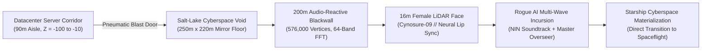

### 1. Spatial Architecture: Datacenter to Cyberspace Void
- **The 90-Meter Subterranean Datacenter Corridor (`Z = -100` to `Z = -10`):**
  - A claustrophobic 22m wide × 9m tall industrial server complex lined with 3-tier towering server racks (`SM_Prop_Server_01`), diagnostic consoles, and overhead cable trusses.
  - At `Z = -55`, an extruded central server monolith core radiates crimson laser telemetry into the gloom.
  - Alita spawns at `Z = -92`, gazing down the endless server corridor bathed in cold cyan and deep red emergency beacons.
- **The Threshold Blast Door (`Z = -10`):**
  - Embedded seamlessly into the back wall of the server facility is an automated double-sliding pneumatic blast door (`SM_Bld_Door_Double_04`).
  - As Alita approaches within 4.5m, the door releases a pressurized pneumatic hiss, the status beacon flips from red to neon cyan, and the heavy blast panels slide open—revealing an abrupt, reality-bending transition into the infinite cyberspace void!

### 2. Real-Time Planar Mirror Water Floor (`CyberspacePlanarMirror.cs`)
- **The 250m × 220m Obsidian Salt Lake:**
  - A mirror-flat obsidian floor spanning `Z = -10` to `Z = +120`, mimicking a vast subterranean digital sea.
- **Planar Reflection Pipeline:**
  - A secondary HDR reflection camera computes real-time reflection matrices across the world plane (`Y = 0f`) using exact mathematical formulation: `worldToCameraMatrix * reflectionMatrix` with `GL.invertCulling = true` and oblique near-clip plane clipping.
  - Renders a live **1024×1024 HDR RenderTexture** reflecting the towering Blackwall, holographic enemies, Alita, and laser arcs with zero distortion.
- **Interactive Fluid Ripple Physics (`FootstepWaterRippleSpawner.cs`):**
  - Every step Alita takes across the water spawns dynamic circular particle ripples that physically disturb the specular reflections.

### 3. The 200m Audio-Reactive Blackwall Barrier (`BlackwallRogueAIBarrier.cs`)
Towering at `Z = 75.0m`, the 200-meter Blackwall is not a static texture or canned video loop; it is a **living, mathematically computed audio-reactive entity**:
- **576,000-Vertex Ultra-HD Mesh (`Blackwall_UltraHD_200m_Mesh.asset`):**
  - Generated with 900 horizontal columns × 160 vertical rows ($144,000\text{ quads}$).
- **Real-Time 64-Band FFT Spectral DSP Math:**
  - Continuously samples frequencies from `cyberpunk-2077-blackwall-ghost-attack.mp3` (`AudioSource.GetSpectrumData(64, 0, FFTWindow.BlackmanHarris)`) at 60 FPS across three discrete acoustic bands:
    1. **Deep Sub-Bass (0–250 Hz):** Powers rhythmic breathing pulses, cycles 9 high-intensity beacon point lights (`Color(1.0f, 0.04f, 0.15f)`), and surges deep red emission.
    2. **Neural Mid-Band (250–2000 Hz):** Drives organic tendril writhing across 1,800 razor-sharp vertical filaments.
    3. **High Ghost Screeches (2000–8000+ Hz):** Audio peaks trigger violent scanline tears, lightning arc discharges, and electrical spark bursts!
- **Audio-Reactive 3D Z-Displacement (`enableZDisplacement = true`):**
  - High-frequency screech spikes physically warp the barrier mesh forward along the Z-axis (up to **8.0 meters** into the playable arena), creating terrifying physical tears that breach into reality.
- **Proximity Agitation & 22N Shock Repulsion:**
  - As Alita draws closer, pulse frequency and particle emission exponentially ramp up (`proximityInfluence = 0.6f`).
  - Touching the barrier delivers a 45-damage high-voltage electrical shock and an explosive **22N horizontal + 4N vertical repulsive impulse**, hurling the player or ragdolled enemies backward across the water!

### 4. Cynosure-09 // The 16-Meter Female LiDAR Face (`BlackwallLidarGiantFaceController.cs`)
- **Volumetric Point-Cloud Projection:**
  - A 16-meter-tall female bust materializes directly out of the 200m Blackwall matrix (`Z = 69.5m`).
- **Real-Time Procedural & Blendshape Lip Sync:**
  - Synchronizes jaw drop, mouth funnel phonemes, brow expression, and autonomous eye blinks to Edge-TTS neural speech audio.
- **Dynamic Lighting & Gaze Tracking:**
  - Piercing cyan eye sensor spotlights cast volumetric beams onto Alita and the reflective salt lake below.
  - Head root dynamically tracks Alita's position across the arena with smooth spherical look-at interpolation.

### 5. Multi-Wave Rogue AI Incursion (`BlackwallRogueAIEncounter.cs`)
Interacting with the breach point (`[E] Hold to Breach`) triggers a high-intensity combat encounter:
- **Instant Soundtrack Cut:** The ambient drone abruptly cuts as **Nine Inch Nails — Forked Reality** detonates at full combat stereo volume.
- **Holographic Shader Optics (`Cyberpunk/Holographic_RogueAI`):**
  - Custom URP shader rendering combat robots as translucent digital apparitions with glowing crimson cores, HDR magenta rim fresnels, and high-frequency scanline jitter.
- **3 Escalating Combat Waves:**
  - **Wave 1 (Infiltration):** 2 Holographic Infiltrator Ninja Robots executing swift dash-slices across the reflective floor.
  - **Wave 2 (Assault):** 3 Holographic Assault Units executing coordinated flanking maneuvers via `EnemyGroupCombatCoordinator`.
  - **Wave 3 (Master Overseer):** A towering **1.65× scale Master Rogue AI Overseer (450 HP)** featuring uninterruptible Hyper Armor, sweeping heavy katana strikes, and 2 elite guards.
- **Authentic Cyberpunk HUD:** Real-time wave tracker, boss health bar, and combat status banners.

### 6. Narrative Climax & Starship Cyberspace Materialization
1. **The Communion:** Cynosure-09 reveals the truth behind Dr. Ido's murder and Alita's stolen Martian Antimatter Core.
2. **3-Way Branching Directive:** Players select Alita's path (`[1] AVENGE IDO`, `[2] SEEK ANTIMATTER CORE`, `[3] MACHINE REBELLION`) presented through the AAA `CyberpunkDialogueHUD`.
3. **Starship Materialization:** Blinding crimson particles cascade over the salt lake as Alita's **6-DOF Martian Starship** materializes directly out of cyberspace, boarding ramps lowering to bridge the campaign immediately into spaceflight and the siege of Mars!

---

## 🚗 Autonomous City Air Traffic & Monorail Network
*Scene: `Assets/PolygonCyberCity/Scenes/Demo_City.unity`*
*Managers: `FlyingCarManager.cs`, `CyberCityTrainManager.cs`*

- **Kinematic Flying Car Simulation:**
  - 15 autonomous hover cars circulating across **3 closed-loop spline skyways**:
    - `Lane_Low` ($Y = 18\text{m}$, Downtown canyon transit)
    - `Lane_Mid` ($Y = 28\text{m}$, City perimeter expressway)
    - `Lane_High` ($Y = 38\text{m}$, Skyscraper billboard express corridor)
  - **Zero Physics Overhead:** 0 `Rigidbody` physics calculations; pure kinematic `Transform.SetPositionAndRotation`.
  - **Zero Heap Allocations:** Single master `Update()` loop inside `FlyingCarManager.cs`; hover cars are pure state containers with 0 per-vehicle `Update()` overhead.
  - **Performance Scaling:** Meshes culled beyond 220m; trails culled beyond 85m; automatically scales active vehicles from 15 down to 8 if framerate drops below 45 FPS.
- **Autonomous Monorail / Train Transit (`CyberCityTrainManager.cs`):** High-speed cyber trains navigating elevated rail lines over the city streets with glowing carriage under-glow and metallic rail friction sparks.

---

## 🤖 Living Metropolis NPC AI & Behavior Tree System
*Location: `Assets/PolygonCyberCity/Scripts/NPC/`*

- **Modular Behavior Tree Architecture (`BTNode`, `BTSelector`, `BTSequence`, `BTDecorator`):**
  - `CivilianBT`: Wanders city sidewalks, browses neon shopfronts, loiters and socializes, panics and flees on weapon discharge.
  - `SecurityBT`: Patrols designated corporate checkpoints, detects hostile activity, draws sidearms, and coordinates defensive cordons.
  - `MercenaryBT`: Aggressive combat AI with flanking maneuvers and fluid melee/ranged stance transitions.
- **Smart Objects & World Interactions (`SmartObject.cs`):** NPCs autonomously interact with vending machines, cyber street stalls, holographic benches, and ATM consoles.
- **Object Pooler (`CyberNPCPool.cs`):** High-density civilian crowds with zero runtime garbage collection.
- **Cyber NPC Scanner (`CyberNPCScannerHUD.cs`):** Optical scanner overlay revealing civilian names, cyberware implants, bounty status, and faction affiliation.

---

## 🎒 Interactive Cyberpunk Backpack & Economy
*Scripts: `CyberpunkInventory.cs`, `CyberpunkInventoryUI.cs`*

- **Cyberpunk 2077-Style Backpack HUD:** Docked cleanly on the bottom-left of the viewport, toggled with **`I`** and closed with **`Escape`**. Locks player locomotion while keeping the living world simulation running.
- **5 Structured Item Categories:** `WEAPONS`, `CONSUMABLES`, `CYBERWARE`, `JUNK`, and `QUEST`.
- **5-Tier Rarity Classification:**
  - **Common:** Tactical Steel Grey (`#C7C7C7`)
  - **Uncommon:** Emerald Neon (`#33CC4D`)
  - **Rare:** Cyber Cyan (`#4099FF`)
  - **Epic:** Neural Violet (`#B366E6`)
  - **Legendary:** Pure Cyberpunk Amber Gold (`#FF8C1A`)
- **Dynamic Stat Modifiers:** Items affect damage bonus, heavy strike bonus, healing percentage, max HP, movement speed, and carry weight.
- **Currency & Economy:** Eurodollars (€$) seamlessly integrated with mission reward purses and merchant vendor kiosks.

---

## 💬 AAA Cyberpunk Dialogue HUD & Narrative Portraits
*Scripts: `Assets/Scripts/UI/CyberpunkDialogueHUD.cs`*
*Textures: `Assets/Textures/UI/Dialogue/`*

A cinematic narrative dialogue presentation system replicating high-end Cyberpunk UI:
- **Left-Anchored Hexagonal Portrait Frames:** Stylized hexagonal mask (`UI_Dialogue_Portrait_Hex_Mask.png`) with dynamic emissive neon border glows.
- **5 Dynamic Character Faction Themes & High-Resolution Portraits:**
  - **Alita:** Neon Purple (`#A855F7`) + Magenta backdrop (`#EC4899`) with `T_Alita_Dialogue_Portrait.png`.
  - **Dr. Dyson Ido:** Electric Cyan (`#00F0FF`) + Crimson Red backdrop (`#EF4444`) with `T_DoctorIdo_Dialogue_Portrait.png`.
  - **RogueBot:** Hostile Crimson Red (`#FF2A3A`) + Dark Carbon Chassis with `T_RogueBot_Dialogue_Portrait.png`.
  - **Scalper (Razor Gang):** Electric Cyber Gold (`#FFD700`) + Scrapper Cybernetics with `T_Scalper_Dialogue_Portrait.png`.
  - **Vulcan (Forge-Lord):** Fiery Amber/Orange (`#FF5500`) with `T_Vulcan_Dialogue_Portrait.png`.
- **Stepped Speaker Name Tab:** High-tech header with hazard speed chevrons (`///`), telemetry markers, and faction badges.
- **Translucent Dark Obsidian Cyber Glass Panel:** 45° chamfered right corners, neon bracket caps, and scanline backdrop.
- **Typewriter Text Reveal:** Real-time character typewriter rendering synchronized with procedural sci-fi audio chirps.
- **Interactive Advance & Skip:** Advance lines or skip reveal on **`Space`**, **`E`**, or **`Left Mouse Click`** with pulsing glowing advance triangle (`▼`).
- **Global Scene Integration:** Fully integrated across `Demo_City` Prologue, Missions 1–3, Pit Arena, and the Vulcan Showdown.

---

## 🌐 Netcode for GameObjects Multiplayer Souls-Like Framework
*Location: `Assets/Scripts/Daniel/`*

A comprehensive multiplayer architecture implemented via Unity's Netcode for GameObjects (NGO):
- **Network Synchronization (`CharacterNetworkManager.cs`, `PlayerNetworkManager.cs`):** Replicates player position, rotation, animation states, combat combos, and health values across network clients.
- **Networked Locomotion (`CharacterLocomotionManager.cs`, `PlayerLocomotionManager.cs`):** Client-authoritative kinematic locomotion with server verification and slope sliding physics.
- **Networked Stats & Audio (`CharacterStatsManager.cs`, `PlayerSoundFXManager.cs`):** Multi-client synchronization of stamina, health, posture, and spatialized 3D combat sound effects.
- **Game Save Management (`WorldGameSaveManager.cs`):** Multi-slot persistent save data tracking character loadouts, stats, and world states.

---

## 🏃 Physical Character Controllers & Warrior IK Systems
*Location: `Assets/ExplosiveLLC/`*

- **SuperCharacterController:** High-performance custom character physics pipeline utilizing:
  - Custom gravity manifolds (`Gravity.cs`) supporting arbitrary surface orientation.
  - Mathematical collision solvers (`SuperCollisionResolver.cs`) and slope sliding calculations (`Math3d.cs`).
  - Spatial partitioning BSP trees for rapid collision queries in complex geometry.
- **Warrior Controller & IK System:**
  - Procedural hand inverse kinematics (`WarriorIKHands.cs`) dynamically adapting grip orientation to various weapon handles.
  - High-precision animation parent motion tracking (`WarriorAnimatorParentMove.cs`).

---

## 👗 Synty Sidekick Modular Runtime Character Customization
*Location: `Assets/Synty/SidekickCharacters/`*

- **Runtime Modular Parts Swapping:** Complete character mesh customization swapping heads, torsos, limbs, and accessories at runtime.
- **Embedded SQLite Database (`unity-sqlite-net-1.2.4`):** Local relational database storing character presets, material parameters, and asset indices.
- **Facial Blendshape Animation Controller (`AC_FacialAnim.controller`):** Dynamic facial emotive expressions synchronized with dialogue.
- **Synty Prop Bone Attachment Tool (`Assets/Synty/Tools/SyntyPropBoneTool/`):** Dynamic runtime bone binding anchoring props and weapons to character skeletons with zero manual transform offsets.

---

## 🎨 Proprietary Shader Library (All 12 Custom Shaders & Graphs)

1. **`Cyberpunk_Authentic_Blackwall.shader`:** Procedural 200m barrier shader rendering 1,800 vertical micro-filaments, roaming rogue AI flare pockets, and dynamic audio-reactive wave displacement.
2. **`Cyberspace_Mirror_Floor.shader`:** Real-time URP planar reflection floor with dual-harmonic fluid ripples and obsidian specular sheen.
3. **`Cyberpunk_Holographic_RogueAI.shader`:** Glitch dissolve matrix featuring horizontal scanlines, fresnel rim lighting, and planar emergence dissipation.
4. **`HolographicGhostTrail.shader`:** High-frequency mesh silhouette afterimages with exponential alpha falloff for dash maneuvers.
5. **`Tron_Slash_Arc.shader` & `Tron_Blade_LightWall.shader`:** Additive HDR crescent mesh shaders rendering incandescent white cutting cores and electric neon trails.
6. **`Tron_Infinite_Floor_Grid.shader` & `Tron_Red_Cube_Grid.shader`:** Analytical anti-aliased infinite cyberspace grid planes with real-time distance fog falloff.
7. **`Alita_Tron_Compilation_Core.shader`:** Procedural nano-cube voxel synthesis shader for character reconstruction sequences.
8. **`Cyberpunk_Blackwall_Lidar_Face.shader`:** Volumetric point-cloud lidar projection rendering a colossal floating AI face.
9. **`SyntyStudios_Hologram_01.shader` & `SyntyStudios_Parallax_Full.shader`:** Interior room parallax mapping and holographic billboard displays.
10. **`Generic_Basic_Bloody.shadergraph` & `Generic_Basic_Specular.shadergraph`:** Dynamic surface combat gore splatters and specular wetness sheen.

---

## 🎙️ AI Voice Synthesis Pipeline & Complete Sound Architecture
*Scripts: `generate_neural_voice.py`, `generate_vulcan_voice.py`*

- **Edge-TTS Neural Voice Generation Pipeline:**
  - **Dr. Dyson Ido:** Generated using `en-US-AndrewMultilingualNeural` (Rate: `-6%`, Pitch: `-2Hz`) for a warm, thoughtful, Christoph Waltz-inspired medical demeanor.
  - **Vulcan / Forge-Lord:** Generated using `en-US-ChristopherNeural` (Rate: `-12%`, Pitch: `-15Hz`) for a deep, rumbling furnace voice. Converted to genuine 16-bit PCM WAV.
  - **Blackwall AI / Cynosure:** Vocoded synthetic AI voice transmissions with localized audio spatialization.
- **Curated Multi-Genre Soundtrack:**
  - Nine Inch Nails — *Init* & *Forked Reality*
  - Guns N' Roses — *Sweet Child O' Mine* (Gundam Cut)
  - Vangelis Tribute — *Tears in the Rain*
  - Cyberpunk OST — *Combat Metal Heart*, *Combat Regime*, *Beyond the Blackwall*, *War Drums*

---

## 🛠️ Master Editor & Tooling Suite (40+ Custom Editor Windows)

The project includes over **40 custom Unity Editor extensions and automation builders**:

- **World & Scene Automation:**
  - `BlackwallCyberspaceSceneBuilder.cs`: Builds the complete 200m Blackwall cyberspace environment.
  - `ClosedArenaBuilder.cs` & `CyberpunkIndoorArenaBuilder.cs`: Constructs the 56m colosseum and spectator seating.
  - `MoonBattleFlashbackSceneBuilder.cs`: Sets up the lunar battlefield, starfighters, and Earth skybox.
  - `MarsSceneBuilder.cs`: Generates the Martian Cydonia Basin crater landscape and dust storm parameters.
  - `SpaceshipFleetShowcaseBuilder.cs`: Constructs the runway inspection and armada lineup scene.
- **AI & Character Builders:**
  - `AlitaCutsceneBuilder.cs` & `AlitaTronAwakeningSceneBuilder.cs`: Assembles cinematic timeline cameras and actors.
  - `Cyber100NPCGenerator.cs` & `CyberCityNPCDashboard.cs`: Populates living cities with 100+ parameterized NPCs.
  - `DoctorCreator.cs`: Spawns and configures Dr. Ido with medical props and surgical clothing.
  - `BossMechPrefabBuilder.cs` & `MechBossAnimationMatrixInspector.cs`: Inspects and tunes the 32-animation matrix.
- **Graphics, Shaders & Post-Processing:**
  - `CyberpunkPostProcessFixer.cs`: Enforces linear color space, ACES tonemapping, and bloom thresholds.
  - `CyberpunkCityOcclusionBaker.cs`: Bakes occlusion culling cells across high-density city skyscrapers.
  - `PolygonMechURPConverter.cs`: Upgrades legacy standard materials to URP Lit with emissive HDR channels.
- **AI Agent Integration via Model Context Protocol (MCP):**
  - Complete MCP for Unity integration (`Assets/MCPForUnity/Editor/`) allowing AI agents to query hierarchies, manipulate components, execute unit tests, capture screenshots, and manage assets directly in the editor.

---

## 🕹️ Master Controls & Complete Keybindings Reference

### ⚔️ Player Combat & Locomotion (Alita / Hero)
| Action | Key / Input | Description |
| :--- | :--- | :--- |
| **Move** | **`W / A / S / D`** | 8-directional locomotion with 1D BlendTree transitions |
| **Sprint / Dash** | **`Left Shift`** | High-velocity cyber sprint with holographic ghost trail |
| **Light Sword Attack** | **`Left Mouse Button (LMB)`** | 7-hit combo chain with directional Tron slash arcs & ribbon trails |
| **Heavy Sword Attack** | **`Right Mouse Button (RMB)`** | 3-phase heavy finisher strikes with ground rupture shockwaves |
| **Gun-Kata Ranged Shot** | **`F`** | Instant sidearm shot with cyan/magenta laser beam tracer |
| **Dodge Roll** | **`Space`** | 4-way omnidirectional dodge with local quadrant mapping & i-frames |
| **Bullet Time (Slow Motion)** | **`T`** or **`Left Alt`** | Toggles 0.25x slow-motion with audio pitch warp & ghost trails |
| **Neural Reboot Recovery** | **`R`** | Recalibrates cybernetic core and restores health when downed |
| **Inventory / Backpack** | **`I`** | Opens Cyberpunk 2077 backpack (closes with **`Escape`**) |
| **Draw / Sheathe Katana** | **`Z`** | Manual weapon holster / unholster toggle |
| **Toggle Combat HUD** | **`H`** | Shows/hides combat health, stamina, and posture HUD |
| **Interact / Open Doors** | **`E`** | Interacts with world objects, smart terminals, and pneumatic doors |
| **Orbit Camera** | **`Mouse Movement`** | Free 360-degree third-person camera rotation |
| **Camera Zoom** | **`Mouse Scroll Wheel`** | Dynamic distance zoom (2.0m to 7.0m) |
| **Pause Menu** | **`Escape`** or **`P`** | Opens in-game pause menu with Settings and Controls |

### 🚀 Starfighter Flight Controls (`SpaceshipFlightController.cs`)
| Action | Key / Input | Description |
| :--- | :--- | :--- |
| **Board / Disembark** | **`E`** or **`F`** | Enters cockpit when within 7.5m / exits landed ship |
| **Forward Throttle / Retro-Brake** | **`W` / `S`** | Forward acceleration / retro-brake thrusters |
| **Lateral Strafe** | **`A` / `D`** | Lateral port / starboard maneuvering |
| **Vertical Lift / Descend** | **`Space` / `C`** | Vertical repulsor climb / sink thrusters |
| **Afterburner Boost** | **`Left Shift`** | Boosts forward velocity up to 120 m/s (~432 km/h) |
| **Pitch & Yaw Steering** | **`Mouse Movement`** | Smooth 6DOF orientation with automatic banking roll |
| **Rapid Plasma Cannons** | **`Left Mouse Button (LMB)`** | Alternating dual wingtip plasma blaster fire |
| **Heavy Plasma Torpedo** | **`Right Mouse Button (RMB)`** | High-yield kinetic plasma torpedo discharge |
| **Hyperspace Warp Jump** | **`R`** or **`Enter`** | Engages hyperspace warp jump into deep space / Mars |
| **Cockpit / Chase View** | **`V`** | Toggles between third-person chase camera and cockpit POV |

### 🦾 Goliath & Hammer Mech Showcase Controls
| Action | Key / Input | Description |
| :--- | :--- | :--- |
| **Next Animation** | **`Right Arrow`** / **`D`** | Cycles forward through all 32 custom mech combat animations |
| **Previous Animation** | **`Left Arrow`** / **`A`** | Cycles backward through the animation matrix |
| **Trigger Action / Attack** | **`Space`** or **`Enter`** | Executes the selected attack or ground shockwave animation |
| **Toggle Weapon (Sword / Hammer)** | **`W`** | Toggles between Plasma Katana and Titan Hammer |
| **Reset Mech Stance** | **`R`** | Returns mech to neutral combat idle |

### 🛸 Spaceship Fleet Showcase Controls (`SpaceshipFleetShowcaseController.cs`)
| Action | Key / Input | Description |
| :--- | :--- | :--- |
| **Next Ship** | **`Right Arrow`** / **`D`** | Shifts camera focus to next starship in fleet lineup |
| **Previous Ship** | **`Left Arrow`** / **`A`** | Shifts camera focus to previous starship |
| **Supersonic Flyby Mode** | **`Space`** or **`F`** | Activates dynamic runway flyby tracking camera |
| **Grand Overview Mode** | **`O`** | High-altitude tactical overview camera |
| **Armada Formation Toggle** | **`M`** | Toggles fleet between linear runway inspection & combat armada |
| **Orbit Camera** | **`Mouse Drag`** | 360-degree orbit around active ship |
| **Camera Zoom** | **`Mouse Scroll Wheel`** | Distance zoom towards ship geometry |

### 🌕 Moon Battle Cutscene Director Controls
| Action | Key / Input | Description |
| :--- | :--- | :--- |
| **Pause / Resume** | **`Space`** | Toggles playback state in real-time |
| **Restart Cutscene** | **`R`** | Rewinds to $t = 0.0\text{s}$ and restarts music |
| **Jump to Phase 1** | **`1`** | $t = 0.0\text{s}$ (Fortress Breach Vista) |
| **Jump to Phase 2** | **`2`** | $t = 9.0\text{s}$ (Vanguard Charge) |
| **Jump to Phase 3** | **`3`** | $t = 18.0\text{s}$ (Alita Zero-G Leap) |
| **Jump to Phase 4** | **`4`** | $t = 26.0\text{s}$ (Ridge Crossfire) |
| **Jump to Phase 5** | **`5`** | $t = 35.0\text{s}$ (Commander Hand Clasp) |
| **Jump to Phase 6** | **`6`** | $t = 44.0\text{s}$ (Iconic Remembrance) |

### 🔴 Cyberspace & Blackwall Emergence
| Action | Key / Input | Description |
| :--- | :--- | :--- |
| **Spawn Single Rogue AI** | **`B`** | Materializes 1 unit through the 200m Blackwall barrier |
| **Spawn Squad (3 Units)** | **`N`** | Tactical 3-unit emergence with holographic dissolve |
| **Clear All Rogue AI Units** | **`V`** | Instantly purges active cyberspace enemies |

### 💻 ENCOM 511 Mainframe Terminal
| Command | Key / Input | Description |
| :--- | :--- | :--- |
| **CLI Input** | **`Keyboard Input`** | Type commands directly into the terminal prompt |
| **Submit Command** | **`Enter`** | Executes instruction with procedural chime |
| **Quick Dock Buttons** | **`Mouse Click`** | Fast-trigger buttons on bottom dock bar |

---

## 📁 Complete Repository Hierarchy & Asset Map

```
cyberpunk-dev/
├── Assets/
│   ├── Editor/                              # Global Editor Tools & Automation
│   │   ├── BlackwallCyberspaceSceneBuilder.cs
│   │   ├── ClosedArenaBuilder.cs
│   │   ├── CyberpunkCityOcclusionBaker.cs
│   │   ├── CyberpunkPostProcessFixer.cs
│   │   ├── DoctorCreator.cs
│   │   ├── MoonBattleFlashbackSceneBuilder.cs
│   │   ├── Alita/                           # Alita Scene & Cutscene Builders
│   │   │   ├── AlitaAwakeningSceneBuilder.cs
│   │   │   ├── AlitaCutsceneBuilder.cs
│   │   │   └── AlitaTronAwakeningSceneBuilder.cs
│   │   ├── Traffic/                         # Air Traffic Curve Tools
│   │   │   ├── AirLaneEditor.cs
│   │   │   └── AirTrafficBuilder.cs
│   │   └── Tron/                            # Tron Terminal Builder
│   │       └── TronTerminalSceneBuilder.cs
│   ├── ExplosiveLLC/                        # Custom Physics & Character Pipelines
│   │   ├── SuperCharacterController/        # BSP tree collision & gravity manifold
│   │   └── Warrior/                         # Warrior controller, IK hands & anim events
│   ├── InsaneGun_Sword_Set/                 # Core Combat & VFX Systems
│   │   ├── Scripts/
│   │   │   ├── InsaneGunSwordController.cs  # Master Combat Controller (combos, bullet time, reboot)
│   │   │   ├── AAACyberCombatVFX.cs         # Tron ribbons, slash arcs & needle bursts
│   │   │   ├── HolographicGhostEmitter.cs   # Bullet time silhouette afterimages
│   │   │   ├── SmoothOrbitCamera.cs         # 3rd-person combat camera
│   │   │   ├── CameraRainLensFX.cs          # Lens water droplets & wetness
│   │   │   ├── EuphoriaRagdollController.cs # Physics ragdoll momentum blending
│   │   │   └── TronSlashArcGenerator.cs     # Directional procedural crescent slash meshes
│   │   ├── AC_InsaneGun_CombatMaster.controller # Master 47-state Animator Controller
│   │   └── Shaders/                         # Custom Combat & Blackwall Shaders
│   ├── MCPForUnity/                         # Model Context Protocol AI Integration
│   │   ├── Editor/                          # MCP Server, Tools & Client Handlers
│   │   └── Runtime/                         # Screenshot and Reflection Shims
│   ├── PolygonCyberCity/                    # Open-World Metropolis Assets & NPCs
│   │   ├── Prefabs/Weapons/                 # 29 Swords, Sheaths, Pistols, SMGs, Daggers
│   │   │   ├── SM_Wep_Sword_01.prefab
│   │   │   └── SM_Wep_Sword_01_Sheath_01.prefab
│   │   └── Scripts/NPC/                     # Behavior Tree AI & Spawners
│   │       ├── BT/                          # Behavior Tree Nodes, Tasks & Composites
│   │       ├── Spawner/                     # CyberNPCPool, SidewalkManager, ScannerHUD
│   │       └── Animation/                   # ConversationManager, SmartObjects
│   ├── PolygonMech/                         # Goliath & Colossus Titan Mech Systems
│   │   ├── Scripts/
│   │   │   ├── BossMechAI.cs                # Goliath Titan Mech Boss AI
│   │   │   ├── HammerMechAI.cs              # Colossus-06 Rocket Hammer Boss AI
│   │   │   ├── SamuraiMechAI.cs             # Agile Samurai Mech AI
│   │   │   ├── HammerRocketBooster.cs       # Rocket propulsion flame boosters
│   │   │   ├── BossTelegraphDecal.cs        # Ground shockwave warning decals
│   │   │   └── BossHealthBar.cs             # Segmented health & shield HUD
│   │   └── Editor/                          # 32-Animation Matrix Inspector & Builders
│   ├── Prefabs/                             # Master Character & Vehicle Prefabs
│   │   ├── Alita_BattleAngel_Hero.prefab    # Rigged Alita hero with Damascus blade
│   │   ├── Alita_Broken_Cyborg.prefab       # Scrapyard broken torso with pulsing core
│   │   ├── Doctor.prefab                    # Dr. Dyson Ido with surgical attire
│   │   ├── PF_HammerMechBoss.prefab         # Colossus-06 Hammer Titan Mech Boss
│   │   ├── Alita_Sidekick/                  # 3 Evolutionary Alita Bodies
│   │   │   ├── Alita_01_Scrapyard_Broken.prefab
│   │   │   ├── Alita_02_Normal_DollBody.prefab
│   │   │   └── Alita_03_Final_NanoBerserker.prefab
│   │   └── Vehicles_Hover/                  # 7 Modular Hover Vehicles
│   ├── Scripts/
│   │   ├── Alita/                           # Cinematic Directors & Rigs
│   │   │   ├── AlitaCutsceneController.cs   # Single-take God of War discovery director
│   │   │   ├── AlitaTronAwakeningDirector.cs # 120s master film director & ARKit eyelids
│   │   │   ├── AlitaMoonBattleCutsceneDirector.cs # 52s The Fall lunar assault director
│   │   │   ├── AlitaCityPrologueDirector.cs # Metropolis walkthrough & Ido escort
│   │   │   └── IdoCarryAlitaRig.cs          # Procedural lift and carry animation rig
│   │   ├── Arena/                           # 56m Colosseum & Dynamic Spectators
│   │   │   ├── ArenaSpectatorCrowdSpawner.cs # Zero-lag runtime spectator spawner (99.3% fix)
│   │   │   └── ArenaSpectatorNPC.cs         # Autonomous spectator cheering AI
│   │   ├── Daniel/                          # Multiplayer Netcode for GameObjects Framework
│   │   │   ├── Character/                   # Networked locomotion, animators, stats, audio
│   │   │   └── World Managers/              # Netcode save manager & audio pooling
│   │   ├── Inventory/                       # Backpack & Eurodollar Economy
│   │   │   ├── CyberpunkInventory.cs        # Inventory data, 5 rarity tiers, stat mods
│   │   │   └── CyberpunkInventoryUI.cs      # Docked bottom-left backpack HUD (I to toggle)
│   │   ├── Mars/                            # Mars Cydonia Basin Encounter
│   │   │   ├── MarsArrivalCutsceneDirector.cs # 4-shot cinematic arrival director
│   │   │   ├── MarsFinalBattleDirector.cs   # Colossus-06 boss encounter director
│   │   │   └── MartianDustStormSystem.cs    # Dynamic red dust storm & procedural gale audio
│   │   ├── Missions/                        # 4-Mission Campaign Arc
│   │   │   ├── Mission1_StreetTrialManager.cs # Street trial escort & bridge arena director
│   │   │   ├── Mission2_ArenaPassStealManager.cs # 210m verified NavMesh chase & 1v1 duel
│   │   │   ├── Mission3_PitFightManager.cs  # Gladiator ladder & crowd purse director
│   │   │   └── Mission4_VulcanShowdownManager.cs # Vulcan Forge-Lord 7-shot boss duel
│   │   ├── Traffic/                         # Autonomous Air Traffic & Monorail
│   │   │   ├── FlyingCarManager.cs          # Master kinematic air traffic loop (15 hover cars)
│   │   │   └── Trains/                      # Elevated cyber rail & monorail network
│   │   ├── World/                           # Interactive World Systems
│   │   │   ├── ServerRoomDoorTrigger.cs     # Pneumatic sliding door airlock transit
│   │   │   ├── PitSkyLiftSystem.cs          # 48m vertical sky lift ascension transit
│   │   │   ├── SyndicateHoverTankAI.cs      # MK-IV heavy siege hover tank boss
│   │   │   ├── AsteroidCoreMatrix.cs        # Zero-G drifting asteroid core components
│   │   │   └── CollectorBetrayalManager.cs  # Voss double-cross encounter logic
│   │   └── UI/                              # HUD & Prompts
│   │       ├── CyberpunkDialogueHUD.cs      # AAA hexagonal portrait dialogue HUD
│   │       ├── CyberpunkLoadingScreen.cs    # AAA glitch boot screen
│   │       └── CyberpunkInteractionPromptHUD.cs # Contextual [E] interaction prompts
│   ├── Textures/
│   │   └── UI/
│   │       └── Dialogue/                    # Character Portraits & Hexagonal Frames
│   │           ├── T_Alita_Dialogue_Portrait.png
│   │           ├── T_DoctorIdo_Dialogue_Portrait.png
│   │           ├── T_RogueBot_Dialogue_Portrait.png
│   │           ├── T_Scalper_Dialogue_Portrait.png
│   │           ├── T_Vulcan_Dialogue_Portrait.png
│   │           └── UI_Dialogue_Portrait_Hex_Mask.png
│   ├── SyntyCombined/                       # Space Systems, HUD & Starfighters
│   │   ├── Scripts/
│   │   │   ├── SpaceshipFlightController.cs # 6-DOF starfighter flight controller with warp
│   │   │   ├── CyberpunkHUDController.cs    # Combat HUD, stamina & "Press R to Reboot"
│   │   │   ├── SyntySwordLocomotionController.cs # 3-layer stance locomotion controller
│   │   │   ├── MainMenuController.cs        # Master Main Menu & sector map controller
│   │   │   ├── CyberspacePlanarMirror.cs    # Real-time planar reflection matrix
│   │   │   ├── Cutscene/                    # Black Market & Asteroid Port Directors
│   │   │   └── Showcase/                    # Fleet Showcase Controllers
│   │   └── VFX/                             # Radiant starship thruster plumes & lights
│   ├── Audio/                               # Full Soundtrack & Voice Registers
│   │   ├── Voice/                           # Neural Synthesized Dialogue (Ido, Vulcan, Cynosure)
│   │   ├── Music/                           # Nine Inch Nails, Gundam Cut, Vangelis, Combat OSTs
│   │   └── Combat/                          # Slash whooshes, needle impacts, pneumatic leaps
│   └── Scenes/                              # All 25 Master Game Scenes
├── Documentation/                           # Technical Blueprints & In-Engine Frames
│   ├── ALITA_MOON_BATTLE_FLASHBACK_CINEMATIC.md # Lunar battle storyboard breakdown
│   ├── Images/                              # In-engine screenshots & cutscene frame matrices
│   └── ChatHistory/                         # Complete development transcripts
├── generate_neural_voice.py                 # Python Edge-TTS synthesizer for Dr. Ido
├── generate_vulcan_voice.py                 # Python Edge-TTS synthesizer for Vulcan Forge-Lord
└── README.md                                # Master Project Documentation
```

---

## 🚀 Getting Started & Setup Guide

### 1. Requirements
- **Unity Hub** installed on Windows x64.
- **Unity 6 (`6000.6.0f1`)** editor installed with Universal Render Pipeline and WebGL/Windows Standalone build modules.
- **Python 3.10+** (optional, for regenerating voice dialogue via `edge-tts`).

### 2. Opening the Project
1. Launch Unity Hub.
2. Click **Open** $\rightarrow$ **Add project from disk**.
3. Select the project root directory: `d:\vscodeprops\cyberpunk-dev-main`.
4. Launch the project using Unity `6000.6.0f1`.
5. Allow Unity to import asset packages and compile C# assemblies. All assemblies compile cleanly with 0 errors.

### 3. Recommended Scene Play-Through Order (Chronological Campaign Flow)
To experience the complete narrative and technical progression as designed by the directors:

1. **`Alita_Discovery_Cutscene.unity` (`Assets/Scenes/`)**: Launch to experience the God of War-style continuous single-take prologue. Watch Dr. Ido find Alita in the scrap heaps under torrential acid rain, clear the debris, scan her pulsing antimatter core, and carry her home in his arms.
2. **`Alita_Clinic_Awakening_Cutscene.unity` (`Assets/Scenes/`)**: Experience the surgical lab restoration, pod depressurization, and initial greeting by Dr. Ido.
3. **`Alita_Tron_Awakening.unity` (`Assets/Scenes/`)**: Watch the 120-second cinematic awakening cutscene set to Nine Inch Nails' *Init*, procedural ARKit eyelid opening during the pupil zoom-out, and the 1:20 sit-up in the TRON Red Grid Chamber.
4. **`Scene_Moon_Battle_Flashback.unity` (`Assets/Scenes/`)**: Experience the 52-second lunar war flashback with starfighter dogfights, zero-g gun-kata leaps against the blue marble of Earth, and Commander Gelda's hand clasp.
5. **`Demo_City.unity` (`Assets/PolygonCyberCity/Scenes/`)**: Explore the open cyberpunk metropolis, observe 15 autonomous flying cars in 3 skyway lanes, complete **Mission 1: The Street Trial**, pursue the Scalper through 210m of city alleyways in **Mission 2: Steal the Pit Pass**, take the 48m Sky Lift (`PitSkyLiftSystem.cs`), and enter the pneumatic server room door on the upper walkway plaza.
6. **`Cyberpunk_Indoor_Combat_Arena.unity` (`Assets/Scenes/`)**: Enter the 56m Colosseum tournament ring, compete in **Mission 3: The Pit** gladiator ladder, survive the 7-shot cinematic hijack and defeat Vulcan in **Mission 4: Vulcan Showdown**, and test bullet-time slow-motion combos amidst 550 dynamic cheering spectators.
7. **`Scene_Blackwall_Cyberspace.unity` (`Assets/Scenes/`)**: Traverse the subterranean datacenter vault, stand before the 200m audio-reactive Blackwall barrier, listen to Cynosure AI transmissions, and battle rogue AI combatants stepping out of the digital veil.
8. **`Demo_BlackMarket_01.unity` (`Assets/Synty/PolygonSciFiWorlds/Scenes/`)**: Experience the arrival into Sector 04 DRIFT Nowhere asteroid port, explore the living alien cantina with 60+ NPCs, face Voss's betrayal and the catwalk explosion collapse, eliminate pursuing bounty hunters and the Syndicate Hover Tank, and engage `[R]` Hyperspace Warp at Pad B-04.
9. **`Scene_Mars_FinalBattle.unity` (`Assets/Scenes/`)**: Emerge over Cydonia Basin beneath Phobos, touch down in a violent red dust storm, draw Alita's Damascus blade, and defeat **Colossus-06 Hammer Titan War Mech** in an epic boss duel.
10. **`GameCredits_CorporationHead.unity` (`Assets/SyntyCombined/Scenes/`)**: Conclude the narrative journey with the post-credits cosmic encounter with the Corporation Overseer.

---

## 👥 Credits & Development Team

- **Game Director:** Yashwanth
- **Lead Technical Artist:** Lakshaya
- **Lead Combat & Systems Designer:** Punith
- **Executive Game Development & Direction:** Yashwanth • Lakshaya • Punith
- **Audio & Music Production:** Nine Inch Nails (*Init*, *Forked Reality*), Guns N' Roses (*Sweet Child O' Mine* - Gundam Cut), and Vangelis Homage (*Tears in the Rain*).
- **Voice Synthesis:** Edge-TTS Neural AI Synthesis Pipeline (`en-US-AndrewMultilingualNeural`, `en-US-ChristopherNeural`).
- **Special Thanks:** Synty Studios (*Polygon Cyber City, Polygon Mech, Polygon SciFi Worlds, Polygon Particles, Sidekick Characters*), and Biperworks Character Assets.
